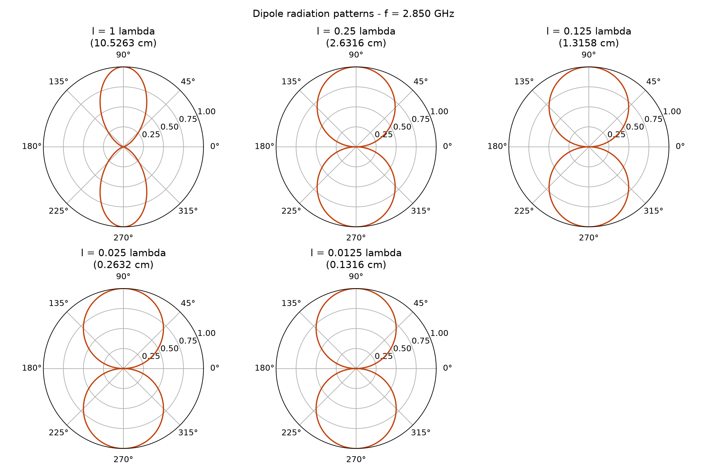

# Activity 02 - Dipole and rectangular patch antennas

This activity examines how electrical length affects a dipole radiation pattern and how frequency, substrate properties and feed impedance affect a rectangular microstrip patch. The results were generated with the Python models supplied for the laboratory.

## 1. Individual parameters

The parameter value N = 89 gives a dipole frequency of 2,400 + 9 × 50 = 2,850 MHz. Using c = 3 × 10⁸ m/s, the wavelength is 0.105263 m, or 10.5263 cm.

For patch antenna 1, the relative permittivity is 2.2 + 4 × 0.3 = 3.4.

## 2. Dipole electrical length

| Electrical length | Physical length |
|---|---|
| 1 λ | 10.5263 cm |
| 0.25 λ | 2.6316 cm |
| 0.125 λ | 1.3158 cm |
| 0.025 λ | 0.2632 cm |
| 0.0125 λ | 0.1316 cm |

The model uses the normalized field of a thin, center-fed dipole with a sinusoidal current distribution.

> F(θ) ∝ [cos(πl cosθ/λ) − cos(πl/λ)] / sinθ

For very short dipoles, the normalized pattern approaches sinθ. Radiation is strongest perpendicular to the wire and vanishes along the wire axis. The cases with 0.025 λ and 0.0125 λ are therefore very similar in normalized shape.

As the length approaches one wavelength, the main lobe narrows in this model. A full-wavelength dipole still has one main lobe in each half of the plotted plane. Additional lobes should not be inferred merely from the fact that the length reaches 1 λ.

A 10% physical length error changes the electrical length by 10%. Short-dipole normalized patterns remain close to the sinθ limit, while a pattern near one wavelength is more sensitive to the change. Pattern shape must be distinguished from input impedance and absolute field amplitude.

## 3. Rectangular patch design

The feed position y₀ was obtained by requesting the specified input impedance from the supplied model.

| No. | f (GHz) | Relative permittivity | Substrate height | Target input impedance |
|---|---|---|---|---|
| 1 | 2.45 | 3.4 | 0.3 cm | 50 Ω |
| 2 | 2.45 | 2.2 | 0.3 cm | 75 Ω |
| 3 | 5.00 | 2.2 | 0.3 cm | 50 Ω |
| 4 | 2.45 | 2.2 | 0.1 cm | 75 Ω |

| Antenna | Width W | Length L | Feed position y₀ | Directivity |
|---|---|---|---|---|
| 1 | 4.127754 cm | 3.205047 cm | 1.157040 cm | 6.429428 dB |
| 2 | 4.840221 cm | 3.957824 cm | 1.231993 cm | 7.217926 dB |
| 3 | 2.371708 cm | 1.825785 cm | 0.630747 cm | 7.279504 dB |
| 4 | 4.840221 cm | 4.082351 cm | 1.281638 cm | 7.146197 dB |

## 4. Comparisons

Antennas 1 and 2 operate at the same frequency and substrate height. Their permittivities and target impedances differ. The lower permittivity in antenna 2 increases the calculated width and length. Its specified input impedance also changes the feed position. The model gives antenna 2 a higher directivity.

Antennas 1 and 3 operate at 2.45 and 5 GHz, respectively. Their substrate permittivities also differ, so the comparison is not a frequency-only experiment. The higher-frequency antenna is smaller, with width decreasing from 4.1278 to 2.3717 cm and length from 3.2050 to 1.8258 cm.

Antennas 2 and 4 have the same frequency, permittivity and target impedance. Their substrate heights are 0.3 and 0.1 cm. The width remains 4.8402 cm because the width formula does not depend directly on substrate thickness. The thinner substrate increases the calculated length and feed position and slightly reduces directivity in this model.

## 5. Interpreting antenna 4

The input impedance target is used to determine the feed location. It does not reduce the effective permittivity.

Antenna 4 has the same width as antenna 2 and a greater length. Reducing substrate thickness changes effective permittivity and the fringing-field extension. Those changes affect the resonant length, feed position and radiation results.

The comparison therefore attributes the difference to substrate thickness while holding frequency, material permittivity and target impedance fixed.

## 6. Conclusion

Electrical length controls the dipole pattern, while frequency and substrate properties strongly influence patch dimensions. The feed position is a separate design variable used to achieve the desired input impedance.

These results come from analytical antenna models. They describe calculated patterns and dimensions rather than measurements of fabricated antennas.

**AI assistance:** AI helped interpret the assignment, apply N = 89 and organize the model outputs. Dimensions were checked against the supplied model. The discussion was revised to distinguish short-dipole and full-wavelength pattern sensitivity.
