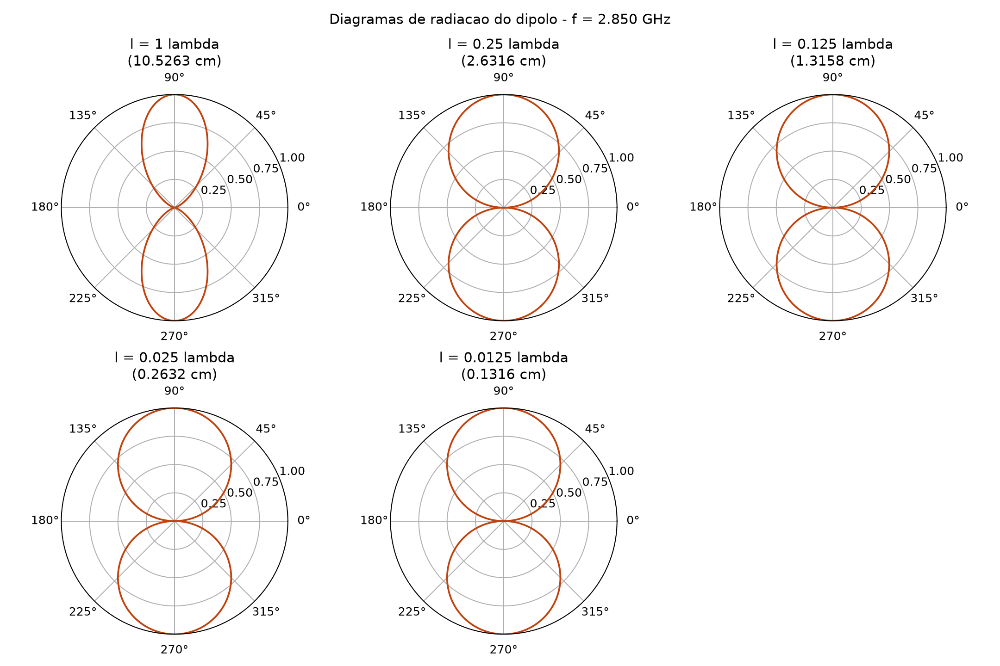

# Atividade 2 - Antenas

## Parametros individuais

Para os dois ultimos digitos da matricula, `N = 89`:

- Frequencia do dipolo: `2400 + (89 mod 10)*50 = 2850 MHz = 2,850 GHz`.
- Permissividade da Antena 1: `2,2 + (89 mod 5)*0,3 = 3,4`.
- Comprimento de onda do dipolo: `lambda = c/f = 0,105263 m = 10,5263 cm`.

## Parte 1 - Dipolo

| Comprimento | Comprimento fisico |
|---:|---:|
| `1 lambda` | 10,5263 cm |
| `0,25 lambda` | 2,6316 cm |
| `0,125 lambda` | 1,3158 cm |
| `0,025 lambda` | 0,2632 cm |
| `0,0125 lambda` | 0,1316 cm |

Os diagramas foram gerados pelo script `gerar_atividade2.py` e estao em `figuras/`:

- `dipolo_1_0lambda.png`
- `dipolo_0_25lambda.png`
- `dipolo_0_125lambda.png`
- `dipolo_0_025lambda.png`
- `dipolo_0_0125lambda.png`

Para comprimentos muito pequenos em relacao a lambda, o diagrama se aproxima do dipolo elementar: ha um lobo largo, com maxima perpendicular ao fio e nulos na direcao do fio. Ao aumentar o comprimento para `0,25 lambda` e depois `1 lambda`, o padrao deixa de ser tao simples; surgem variacoes mais acentuadas e, no caso de `1 lambda`, o lobo principal fica mais estreito no modelo de corrente senoidal. Portanto, o comprimento eletrico controla a quantidade de variacao angular do campo.

Um erro físico de 10% afeta o comprimento elétrico em todos os casos. No limite de dipolo curto, o diagrama normalizado tende a sen(θ) e varia pouco. O caso de comprimento próximo a um comprimento de onda apresenta maior sensibilidade de forma. Isso deve ser distinguido de mudanças de impedância e de amplitude absoluta.

## Parte 2 - Patch retangular

Os valores de `y0` foram obtidos solicitando ao modelo a impedancia de entrada indicada em cada antena.

| Antena | W (cm) | L (cm) | y0 (cm) | Diretividade (dB) |
|---:|---:|---:|---:|---:|
| 1 | 4,127754 | 3,205047 | 1,157040 | 6,429428 |
| 2 | 4,840221 | 3,957824 | 1,231993 | 7,217926 |
| 3 | 2,371708 | 1,825785 | 0,630747 | 7,279504 |
| 4 | 4,840221 | 4,082351 | 1,281638 | 7,146197 |

### Comparacoes

- **Antenas 1 e 2:** a frequência e a espessura do substrato são iguais. A impedância difere, e a permissividade muda de `3,4` para `2,2`. A permissividade menor aumenta `W` e `L`; a impedancia de 75 ohms tambem desloca o ponto de alimentacao para um `y0` maior. A Antena 2 apresentou diretividade maior no modelo.
- **Antenas 1 e 3:** a permissividade, a altura e a impedancia sao comparaveis apenas parcialmente, mas a frequencia sobe de `2,45` para `5 GHz`. O aumento da frequencia reduz aproximadamente pela metade as dimensoes: `W` passa de `4,1278` para `2,3717 cm` e `L` de `3,2050` para `1,8258 cm`. A diretividade permanece proxima e aumenta ligeiramente.
- **Antenas 2 e 4:** frequencia, permissividade e impedancia sao iguais; somente a altura muda de `0,3` para `0,1 cm`. Por isso `W` permanece igual neste modelo, enquanto `L`, `y0` e a diretividade mudam. A Antena 4 tem `L` maior, `y0` maior e diretividade ligeiramente menor.

### Correcao da justificativa da Antena 4

A justificativa possui pelo menos estes erros:

1. A impedancia de entrada nao reduz a permissividade efetiva. A impedancia especificada e usada para determinar a posicao do ponto de alimentacao, depois que as dimensoes e os parametros efetivos do patch foram calculados.
2. A Antena 4 nao e menor que a Antena 2 em todas as dimensoes: neste calculo, `W4 = W2`, mas `L4 > L2`.
3. A espessura do substrato nao afeta somente a posicao do conector. Ela entra no calculo da permissividade efetiva e da extensao de borda, podendo alterar `L` e os demais resultados eletromagneticos. Neste conjunto especifico, `W` nao muda porque a formula usada para `W` nao depende diretamente de `h`.

Assim, a explicacao correta e: as Antenas 2 e 4 usam a mesma frequencia, permissividade e impedancia; a diferenca e a espessura do substrato. Reduzir `h` altera a permissividade efetiva e a extensao de borda, aumentando o comprimento fisico calculado de `3,9578` para `4,0824 cm` neste modelo. Tambem altera `y0` e a diretividade. O valor de `W` permanece igual porque, na formula adotada, ele depende de frequencia e permissividade relativa, mas nao diretamente da espessura.

## Log de uso de IA

- Prompt: informar como realizar a Atividade 2 de antenas a partir do documento fornecido.
- Prompt: calcular os resultados para `N = 89`.
- Prompt: executar os modelos Python existentes e gerar os diagramas e a tabela.

Os valores foram validados executando o modelo Python fornecido no workspace. A discussao foi ajustada para refletir os valores calculados, especialmente o fato de a Antena 4 ter comprimento `L` maior que o da Antena 2.