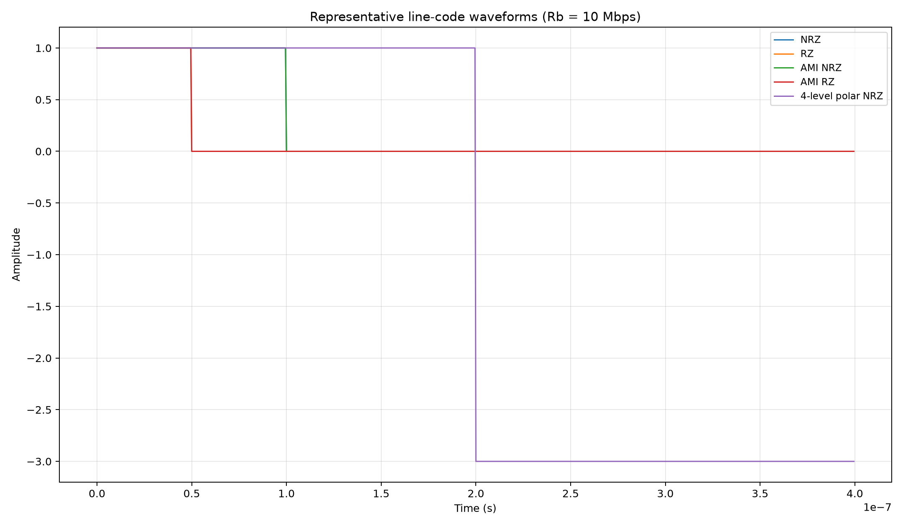
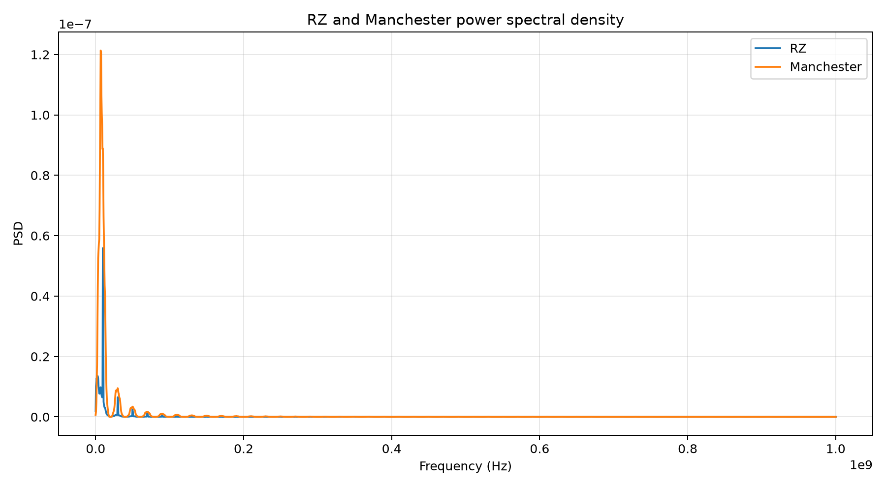
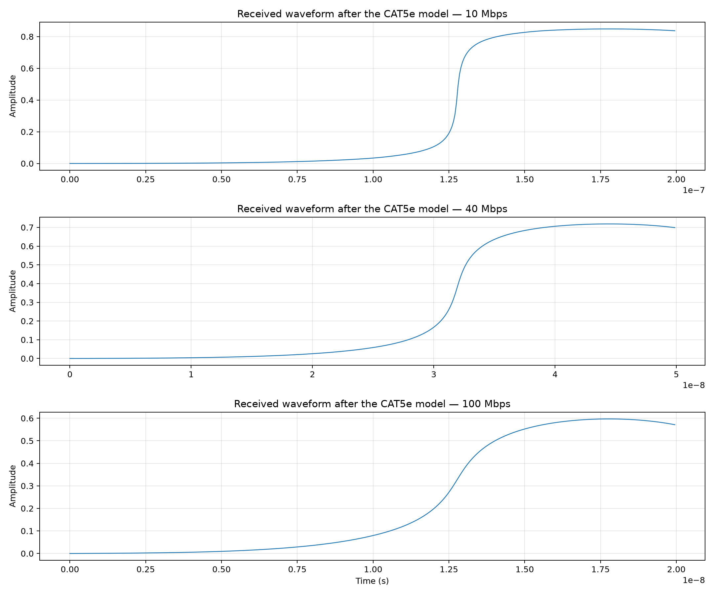

# Activity 03 - Line coding and a CAT5e channel model

This activity compares baseband line codes in the time and frequency domains and examines a modeled CAT5e cable. The objective is to connect pulse shape, spectral occupancy and frequency-dependent attenuation.

## Executive summary

Line coding affects DC content, timing information and the frequency range occupied by a digital signal. Codes with shorter pulses or mandatory transitions spread more energy toward higher frequencies. The cable model attenuates those frequencies more strongly.

The study implements six codes and compares transmission at 10, 40 and 100 Mbit/s through a 49 m cable model. The resulting waveforms illustrate how coding and channel response interact.

## 1. Individual parameters

The activity uses parameter 789 as the random seed. The assigned cable length is

> length = 40 + (789 mod 60) = 49 m

The sequence contains 100 bytes, or 800 bits. The same bits are used for the coding comparisons.

## 2. Baseband transmission model

A line encoder converts bits into electrical pulses. Its pulse shape and symbol mapping determine the power spectral density, DC content, timing transitions and required bandwidth.

The CAT5e model uses insertion-loss values that increase with frequency. A signal with more energy at higher frequencies therefore experiences stronger attenuation of those components.

## 3. Line-code implementations

Each implementation returns a time vector and a sampled baseband waveform.

### 3.1 Unipolar NRZ

A one is represented by a positive level and a zero by zero. Each level lasts for the full bit interval.

The rectangular pulse has its first positive spectral zero at 1/Tb = Rb. The full width between the negative and positive first zeros is 2Rb. The unipolar mean produces a DC component.

### 3.2 Unipolar RZ

A one is high during the first half of the bit and returns to zero for the second half. The pulse is shorter than an NRZ pulse, so its spectral envelope is wider.

### 3.3 Bipolar AMI NRZ

Successive ones alternate between positive and negative levels. Zeros remain at zero. Alternating mark polarity suppresses the DC component in the long-term average.

### 3.4 Bipolar AMI RZ

This code combines AMI polarity alternation with a return to zero within each bit interval. It retains the alternating-mark property while shortening each nonzero pulse.

### 3.5 Quaternary polar NRZ

Each pair of bits selects one of four levels. The symbol rate is half the bit rate, giving a narrower pulse-spectrum envelope than a binary code at the same bit rate. The receiver must distinguish four amplitude levels.

### 3.6 Manchester

A one uses a positive level followed by a negative level. A zero uses the reverse order. Every bit contains a transition at its midpoint, which supplies timing information and gives each ideal bit zero area.

## 4. Simulation settings

The recorded figure-generation script uses seed 789 and 800 random bits. The initial bit rate is 10 Mbit/s and the sample rate is 200 times the bit rate.

Using the same sequence across codes isolates the effect of the encoding rule. The sample rate provides enough points to represent the rectangular pulses and their transitions.

## 5. Time-domain and spectral results

NRZ concentrates more of its spectral content at low frequencies. RZ uses shorter pulses and a broader envelope. Manchester removes the ideal DC component through the opposite half-bit levels. Quaternary coding lowers the symbol rate for the same information rate.

The spectra were estimated with Welch's method. A finite record and finite frequency resolution affect the depth and smoothness of the observed minima.

## 6. Spectral zeros

For 50% duty-cycle unipolar RZ, the rectangular pulse envelope has zeros at

> f = 2nRb, for n = 1, 2, 3, …

The unipolar RZ signal also has a nonzero mean. Its DC contribution must be distinguished from the zeros of the pulse envelope.

Manchester has a zero at DC and additional zeros at the nonzero even multiples of Rb. The reversal within each bit creates the DC cancellation. Its first nonzero positive null is 2Rb.

At Rb = 10 Mbit/s, the positive envelope nulls of both codes occur at 20, 40 and 60 MHz. Manchester additionally has the DC null. The earlier interpretation placing Manchester nulls at every multiple of Rb was corrected during report review.

## 7. Cable model

The supplied cat5_eth_channel module represents the cable insertion-loss curve as a causal, linear-phase FIR filter. The laboratory model scales insertion loss in dB with cable length.

The stored table covers frequencies up to 100 MHz. Beyond that range, the module uses an analytical extrapolation fitted to the supplied values. The experiment is a simulation of a cable response.

## 8. Transmitted and received signals

Increasing the bit rate moves more of the signal spectrum into the region of stronger cable attenuation. Edges become smoother and high-frequency details lose amplitude.

The historical plots show the beginning of each received record. The 513-tap FIR introduces a delay of 256 samples. This delay and its startup transient must be accounted for before comparing waveform samples directly.

The plots therefore provide a qualitative illustration. A sample-aligned comparison would compensate the filter delay and use a steady section of the record.

## 9. Effect of increasing the bit rate

With a fixed line-code shape, reducing Tb expands the frequency scale of the signal. Frequencies that were weakly attenuated at a lower rate become less representative of the occupied band at a higher rate.

The cable then changes the relative amplitudes of spectral components, altering the waveform. This explains the connection between a higher signaling rate and greater channel distortion in the model.

## 10. Main-lobe width

For a rectangular NRZ pulse, the first positive null is at Rb and the full main-lobe width is 2Rb. Much of the pulse-spectrum energy lies within that region.

A more compact spectrum can place a greater fraction of the signal energy within the lower-loss part of a channel. Bandwidth alone does not fully determine error performance, because signal energy, level spacing, timing recovery and receiver processing also matter.

## 11. Halving cable length

The second length considered in the report is 24.5 m. Since the model scales loss in dB linearly with length, halving the length halves the modeled insertion loss at each frequency.

This increases the received amplitude and reduces frequency-dependent attenuation. The change follows directly from the model's length scaling.

## 12. Comparison of codes

| Code | Spectral characteristic | Channel implication |
|---|---|---|
| Unipolar NRZ | DC component and rectangular-pulse envelope | Relatively compact binary pulse spectrum |
| Unipolar RZ | Shorter pulse and wider envelope | More energy exposed to high-frequency loss |
| AMI NRZ | Alternating mark polarity, suppressed DC | Reduced low-frequency content |
| AMI RZ | Alternating polarity with shorter pulses | Broader envelope than AMI NRZ |
| Quaternary NRZ | Two bits per symbol | Lower symbol rate, more amplitude levels |
| Manchester | DC null and mandatory midpoint transition | Timing information with broader occupancy |

## 13. Discussion

The line code determines the spectrum presented to the cable. The channel then changes that spectrum according to its insertion loss.

Manchester and RZ can place significant energy at higher frequencies than a longer rectangular pulse. Quaternary coding can reduce the symbol rate, while requiring finer amplitude discrimination. Receiver and channel conditions must also be considered.

## 14. Conclusion

The activity connects coding rules to waveform shape, spectral zeros and a frequency-dependent channel response. It also shows why delay compensation and the frequency range of a channel model matter when interpreting simulated waveforms.

The results are model-based. The historical figures include the FIR startup behavior, and frequencies above 100 MHz use extrapolated attenuation.
