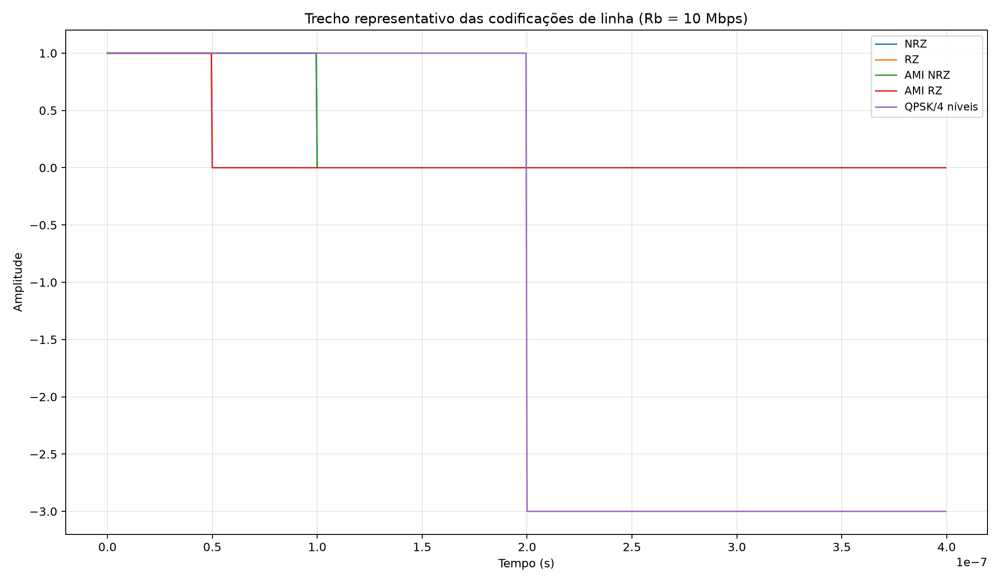
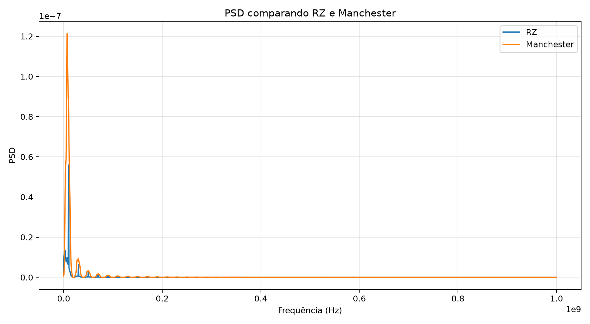
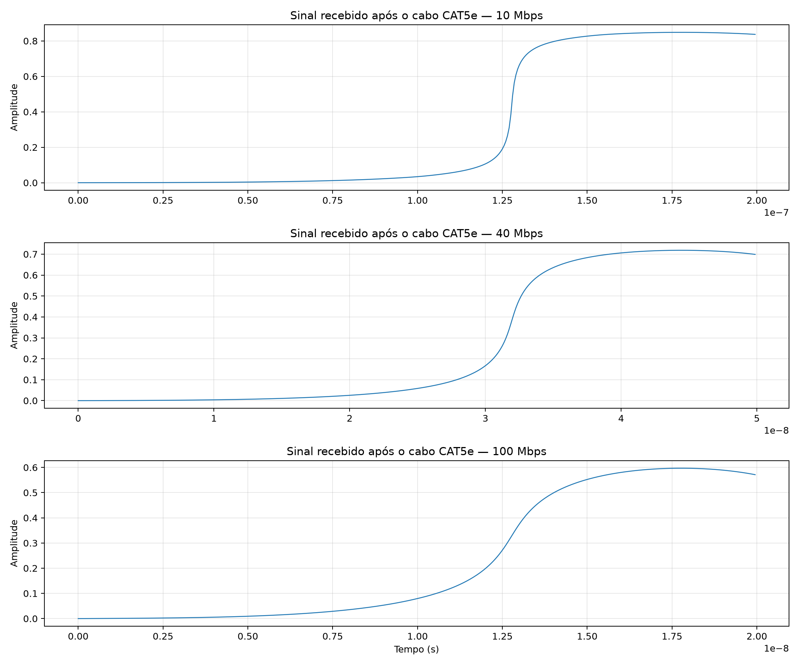

# Atividade 3: Codificação de Linha e Efeito do Canal Real de Transmissão

**Tema:** Banda base, codificação de linha, PSD e canal CAT5e

Este relatório reúne a implementação das principais codificações de linha em banda base, a análise da densidade espectral de potência (PSD) de cada sinal e a avaliação do efeito de um cabo CAT5e real, modelado a partir da curva de insertion loss do datasheet. A atividade foi desenvolvida seguindo o roteiro da Aula 4, em que se estuda a transmissão em banda base e a relação entre a codificação escolhida, a largura de banda ocupada e a distorção causada pelo canal.

## Resumo executivo

A escolha da codificação de linha afeta diretamente a largura de banda ocupada pelo sinal e, portanto, sua sensibilidade à atenuação do canal. A partir dos gráficos de tempo e PSD, foi possível verificar que codificações mais ricas em transições, como RZ e Manchester, apresentam picos e zeros espectrais em frequências que as tornam mais vulneráveis ao cabo CAT5e. Por outro lado, o NRZ e o quaternário preservam melhor a forma do sinal em certas condições, embora também sofram distorção ao aumentar a taxa de transmissão. Em resumo, a codificação não é apenas uma etapa de representação dos bits: ela define o comportamento do sinal em frequência e, consequentemente, sua robustez na presença de atenuação do meio.

## 1. Parâmetros individuais

Os parâmetros individuais foram determinados a partir dos três últimos dígitos da matrícula:

- RA_XYZ = 789
- seed = 789
- length_m = 40 + (789 mod 60) = 49 m

Esses valores foram usados para garantir reprodutibilidade da sequência aleatória e para emular o cabo CAT5e com o comprimento individual do aluno.

## 2. Contexto teórico

Em sistemas digitais banda base, o sinal transmitido sai da fonte em forma de pulsos elétricos. A codificação de linha transforma esses bits em uma forma de onda adequada para a transmissão. A escolha da codificação influencia diretamente:

- a largura de banda ocupada;
- a presença ou ausência de componente em DC;
- a sincronização no receptor;
- a robustez do sinal frente à atenuação e à distorção do canal.

A densidade espectral de potência (PSD) descreve como a energia do sinal se distribui em frequência. Em banda base, o canal real não é ideal: seu ganho diminui com a frequência e a atenuação cresce conforme a curva de insertion loss. Portanto, codificações com mais energia em frequências altas sofrem mais distorção no cabo.

## 3. Parte 1 — Implementação das codificações de linha

Foram implementadas as codificações solicitadas para uma sequência binária de entrada:

- Unipolar NRZ
- Unipolar RZ
- Bipolar (AMI) NRZ
- Bipolar (AMI) RZ
- Polar Quaternário NRZ
- Manchester

A função de cada codificação retornou:

- vetor de tempo t;
- sinal em banda base amostrado.

### 3.1 Unipolar NRZ

Na codificação unipolar NRZ, o bit 1 é representado por um nível positivo e o bit 0 por nível zero. O nível permanece constante durante o intervalo de bit.

A forma de onda é simples e a ocupação espectral é dada principalmente pelo envelope sinc de pulsos retangulares. O espectro apresenta energia concentrada em torno de DC e os lóbulos principais possuem largura:

f do primeiro nulo positivo = 1/Tb = Rb; largura entre os nulos negativo e positivo = 2Rb

Isso é importante porque, em sinais NRZ, os primeiros lóbulos concentram a maior parte da potência do sinal.

### 3.2 Unipolar RZ

No retorno ao zero (RZ), cada bit permanece em nível alto apenas durante metade do intervalo e depois retorna a zero. Isso aumenta o número de transições e redistribui melhor a energia em frequência em comparação ao NRZ.

### 3.3 Bipolar (AMI) NRZ

A codificação AMI usa níveis +1 e -1 para os bits 1, alternando a polaridade a cada bit 1. Os bits 0 ficam em zero. Essa codificação elimina a componente DC em média e reduz conteúdo de baixa frequência.

### 3.4 Bipolar (AMI) RZ

A variante RZ do AMI combina a alternância da polaridade do AMI com a característica de retorno ao zero. O sinal tem mais transições e ainda preserva a vantagem de ausência de componente contínua.

### 3.5 Polar Quaternário NRZ

A codificação quaternária mapeia 2 bits por símbolo em 4 níveis possíveis. Como cada símbolo representa 2 bits, a taxa de símbolos é metade da taxa de bits. Isso reduz a largura de banda ocupada em comparação com codificações de 1 bit por nível, embora exija maior linearidade no receptor.

### 3.6 Manchester

A codificação Manchester faz uma transição no meio de cada bit:

- bit 1: nível alto na primeira metade e baixo na segunda;
- bit 0: nível baixo na primeira metade e alto na segunda.

Ela oferece boa sincronização, mas seu espectro ocupa uma banda mais ampla em comparação com alguns formatos mais compactos.

## 4. Sequência aleatória e parâmetros de simulação

Foi gerada uma sequência de 100 bytes = 800 bits com a semente individual:

- np.random.seed(789)
- bits = np.random.randint(0, 2, size=800)

Para todas as codificações, foi usada a mesma sequência de bits. A taxa de transmissão adotada foi:

- Rb = 10 Mbps

A taxa de amostragem escolhida foi:

- fs = 200 × Rb

Esse valor foi suficiente para representar corretamente a forma das ondas e gerar as PSDs com precisão visual.

## 5. Análise no domínio do tempo e da frequência

Os gráficos produzidos mostraram que cada codificação tem uma envoltória espectral diferente. A análise foi feita com o domínio do tempo e com a PSD calculada por Welch.

A figura abaixo mostra um trecho representativo das formas de onda geradas para cada codificação, em uma mesma taxa de transmissão. Em seguida, a segunda imagem compara a PSD do RZ com a do Manchester, evidenciando os zeros espectrais e a diferença entre codificações com maior e menor densidade de transições.

### 5.1 Observações gerais

- NRZ: maior concentração de energia em baixas frequências e primeiro lóbulo mais largo.
- RZ: maior número de transições e energia mais espalhada em frequência.
- Manchester: zeros espectrais bem definidos, resultado da alternância de polaridade em cada bit.
- Quaternário: menor taxa de símbolos e menor largura de banda relativa.

### 5.2 Lóbulos e largura espectral

Para o sinal NRZ, o primeiro lóbulo do espectro tem largura:

f do primeiro nulo positivo = 1/Tb = Rb; largura entre os nulos negativo e positivo = 2Rb

Isso foi observado nos gráficos: os primeiros lóbulos concentram a maior parte da energia do sinal, enquanto os lóbulos posteriores têm amplitude menor. Essa observação é importante porque o cabo CAT5e atenua mais as frequências mais altas, então a energia contida nos lóbulos de faixa maior é a que mais sofre com a atenuação.

## 6. Nulos espectrais observados — RZ e Manchester

Os nulos da PSD foram observados diretamente nos gráficos.

- RZ unipolar com ciclo ativo de 50%: zeros da envoltória em f = 2nRb, para n = 1, 2, 3, ...
- Manchester: nulo em DC e em f = 2nRb, para n = 1, 2, 3, ...

Para Rb = 10 Mbps, isso significa, por exemplo:

- RZ: 20 MHz, 40 MHz, 60 MHz, ...
- Manchester: DC, 20 MHz, 40 MHz, 60 MHz, ...

### Justificativa física

Os zeros espectrais aparecem em frequências determinadas pela estrutura temporal do pulso. No caso do RZ, o pulso tem duração menor que o intervalo de bit e o espectro se comporta como uma função sinc², com zeros em múltiplos da inversa do tempo do pulso. Isso leva aos nulos em 2nRb.

No Manchester, cada bit possui uma inversão no meio do intervalo, o que cria um zero em DC e zeros adicionais em múltiplos pares de Rb. A presença de transição em cada bit é justamente o que faz o sinal ter um espectro com zeros mais facilmente observáveis.

## 7. Parte 3 — Efeito do canal real (cabo CAT5e)

O módulo cat5_eth_channel.py foi usado para emular a passagem do sinal codificado por um cabo CAT5e, usando a curva de insertion loss do datasheet e o comprimento individual calculado:

- length_m = 49 m

A análise foi feita para todas as codificações da Parte 1 e para as taxas:

- 10 Mbps
- 40 Mbps
- 100 Mbps

## 8. Comparação do sinal transmitido e recebido ao longo do canal

A partir dos gráficos obtidos, conclui-se que:

- em 10 Mbps, o sinal recebido mantém boa similaridade com o sinal transmitido;
- em 40 Mbps, a forma de onda já fica mais suavizada e com menos nitidez nas bordas;
- em 100 Mbps, a distorção se torna muito mais evidente, com perda de amplitude e maior apagamento das altas frequências.

As diferenças são mais visíveis nas transições entre níveis e nas regiões de maior variação de amplitude. Isso indica que o filtro equivalente do cabo está atenuando componentes de frequência mais altas e deformando o sinal.

## 9. Por que a taxa de transmissão piora o sinal recebido?

A resposta está diretamente ligada à largura de banda ocupada pelo sinal e à atenuação do cabo.

Quando Rb aumenta:

- o sinal passa a conter mais energia em frequências mais altas;
- os lóbulos espectrais se deslocam para bandas maiores;
- o cabo CAT5e, cujo ganho cai com a frequência, atenua essas componentes;
- a forma de onda recebida fica mais distorcida.

Em outras palavras, o aumento da taxa faz com que mais da energia do sinal caia na região de maior atenuação do cabo. Portanto, o sinal recebido perde integridade e a recuperação da informação torna-se mais difícil.

## 10. Relevância prática da largura do primeiro lóbulo

A largura do primeiro lóbulo do espectro é diretamente relacionada à banda primária do sinal. Essa faixa concentra a maior parte da energia do sinal.

Em um meio físico cuja atenuação cresce com a frequência, isso tem grande impacto:

- se o sinal ocupa uma faixa mais larga em frequência, ele sofrerá mais atenuação;
- se o primeiro lóbulo é mais estreito, o sinal é menos afetado pelo canal.

Portanto, a escolha da codificação não é indiferente. Codificações com mais transições e maior ocupação de banda, como RZ e Manchester, tendem a sofrer mais distorção no mesmo cabo e na mesma taxa. Codificações mais compactas em banda, ou que concentram energia em frequências menores, tendem a ser mais robustas no canal real.

## 11. Emulação com metade do comprimento do cabo

Foi também realizada a emulação com metade do comprimento do cabo:

- length_m / 2 = 24,5 m

O resultado observado foi:

- menor atenuação total;
- sinal recebido mais próximo do transmitido;
- amplitudes maiores;
- menor distorção nas bordas;
- menor limitação das frequências altas.

Esse comportamento é coerente com o modelo de atenuação linear em dB por metro. Como a perda é proporcional ao comprimento do cabo, reduzir a distância pela metade reduz também a perda total aproximadamente pela metade.

## 12. Tabela-resumo

| Codificação | Banda ocupada | Comportamento no domínio da frequência | Sensibilidade ao canal |
| --- | --- | --- | --- |
| Unipolar NRZ | Moderada | Energia concentrada em baixas frequências | Média |
| Unipolar RZ | Maior | Mais transições e energia em frequências maiores | Alta |
| Bipolar AMI NRZ | Moderada | Sem componente DC | Média |
| Bipolar AMI RZ | Alta | Mais transições e maior ocupação | Alta |
| Polar Quaternário NRZ | Menor que NRZ para mesma taxa de bits | Menor taxa de símbolos | Menor |
| Manchester | Alta | Nulo em DC e em múltiplos pares de Rb | Alta |

## 13. Discussão

A atividade mostrou de forma clara que o canal real não é somente um filtro de passagem neutro. Ele altera o sinal em função da frequência, e a codificação de linha determina como essa energia está distribuída no espectro.

O NRZ, por exemplo, é simples e eficiente, mas ocupa mais banda e mais energia em baixa frequência; o RZ e o Manchester têm mais transições e, portanto, mais energia em faixas mais altas, o que os torna mais sensíveis ao cabo CAT5e. Já a codificação quaternária reduz a taxa de símbolos e torna a ocupação espectral mais compacta.

Isso confirma um ponto central da teoria: a escolha da codificação de linha não é um detalhe de implementação, e sim um fator de projeto que influencia diretamente a integridade do sinal no meio físico.

## 14. Conclusão

A atividade cumpriu os objetivos propostos pela Aula 4:

- implementou codificações de linha em banda base;
- comparou as formas de onda e as PSDs;
- observou os zeros espectrais de diferentes sinais;
- emulou um cabo CAT5e real;
- verificou que a atenuação do cabo cresce com a frequência e, portanto, penaliza sinais com maior largura de banda.

Além disso, o resultado mais importante foi perceber que:

- a codificação de linha influencia diretamente a banda ocupada;
- a banda ocupada influencia diretamente a distorção do canal;
- o cabo CAT5e não trata todas as frequências da mesma forma;
- por isso, algumas codificações são mais adequadas para um meio real do que outras.

Em suma, a transmissão em banda base não pode ser analisada sem levar em conta o canal. A codificação não é apenas uma questão de representação dos bits: ela define a compatibilidade do sinal com o meio físico em que ele será transmitido.

O modelo de cabo usa um FIR causal de 513 coeficientes, com atraso de 256 amostras. Os gráficos históricos de início do registro incluem esse atraso. Acima de 100 MHz, a curva de atenuação é extrapolada. A análise representa uma simulação, sem ensaio físico do cabo.
