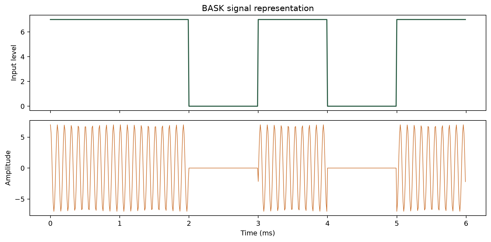
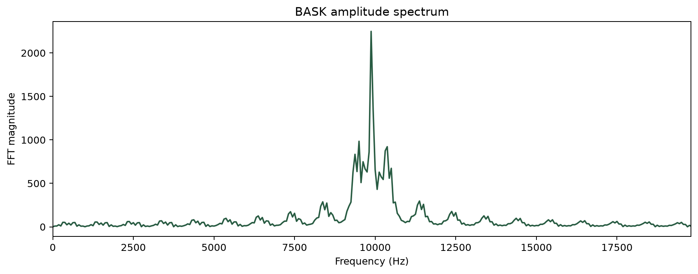
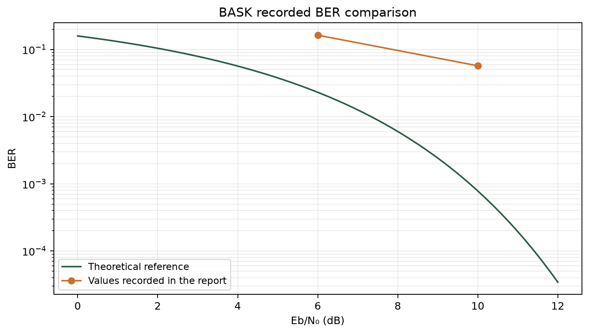

# Activity 04 - Coherent binary amplitude-shift keying

This activity implements binary amplitude-shift keying using an on-off carrier, coherent correlation and a decision threshold. It examines the waveform, spectral envelope and the recorded bit-error-rate comparison in additive white Gaussian noise.

## Executive summary

The modulator multiplies unipolar NRZ data by a cosine carrier. The receiver correlates the received waveform with a phase reference and compares the result with the midpoint between the two expected outputs.

The time-domain and spectral results illustrate the modulation. The recorded BER values differ substantially from the theoretical reference. The energy and noise scaling in the historical generator limit the quantitative conclusion.

## 1. Individual parameters

| Parameter | Value |
|---|---|
| Individual parameter M | 89 |
| Carrier frequency | 1,000 + 100M = 9,900 Hz |
| On-state amplitude A | 3 + (M mod 5) = 7 V |
| Bit rate | 1,000 bit/s |
| Bit interval | 1 ms |
| Sample rate | 100 kHz |
| Random seed | 89 |

The bit interval contains 9.9 carrier cycles. The carrier and the receiver reference therefore need consistent phase tracking across successive bit windows.

## 2. Theoretical model

### 2.1 Signal energy

The on-state waveform is s₁(t) = A cos(2πfct), while the off-state waveform is zero.

> E₁ = A² ∫cos²(2πfct) dt

Neglecting the small oscillatory boundary term gives

> E₁ ≈ A²Tb/2 = 7² × 0.001/2 = 0.0245 J

The exact energy depends on the phase at the beginning of the interval when the cycle count is fractional. For equiprobable on and off symbols, the average energy per bit is approximately E₁/2 = 0.01225 J.

### 2.2 Decision threshold

With a cosine reference, the expected correlator outputs are approximately ATb/2 for an on symbol and zero for an off symbol.

The midpoint threshold is

> Vth ≈ ATb/4 = 0.00175 V·s

The integral has voltage-time units when the reference is dimensionless. For an exact sampled implementation, the threshold should use the actual reference energy in each window.

### 2.3 Null-to-null bandwidth

The NRZ pulse lasts Tb, so the passband envelope has its first nulls approximately 1/Tb from the carrier.

> B ≈ 2/Tb = 2,000 Hz

For a 9.9 kHz carrier, the corresponding envelope boundaries are approximately 8.9 and 10.9 kHz.

## 3. Transmitter and receiver

The report records the bit sequence 1101010011010101. Ones enable the carrier at amplitude A, and zeros suppress it.

> s(t) = b(t) A cos(2πfct)

The coherent receiver multiplies the signal by a synchronized reference and integrates over the bit interval. Comparing the result with the midpoint threshold separates the two states.

## 4. Time and frequency results

The waveform shows carrier bursts during ones. The spectral envelope is centered near the carrier, with width governed by the rectangular bit pulse.

## 5. AWGN and recorded BER

For equiprobable OOK with Eb defined as the average energy per bit, coherent detection gives

> Pb = Q(√(Eb/N₀))

| Eb/N₀ | Theoretical reference | Recorded simulated BER |
|---|---|---|
| 6 dB | 0.02301 | 0.1630 |
| 10 dB | 0.0007827 | 0.05710 |

These values are retained from the existing report. Their difference is too large to explain solely through finite-sample variation.

## 6. Discussion

The noise-free detector depends on an aligned phase reference and a threshold consistent with the correlator normalization. Because fcTb = 9.9, a reference that restarts with the same local phase in every window is not generally equivalent to the continuous transmitter carrier.

The historical BER generator uses the on-state energy as Eb and a decision-noise variance that does not match the theoretical normalization. The observed BER gap therefore identifies a model inconsistency.

A valid numerical comparison requires agreement among the signal energy, the meaning of Eb, the reference energy, the output-noise variance and the decision threshold.

## 7. Conclusion

The activity illustrates on-off carrier modulation, midpoint detection and the approximate 2 kHz main-lobe width. The stored BER curve is useful for identifying a normalization problem, but it does not establish quantitative agreement with coherent OOK theory.
