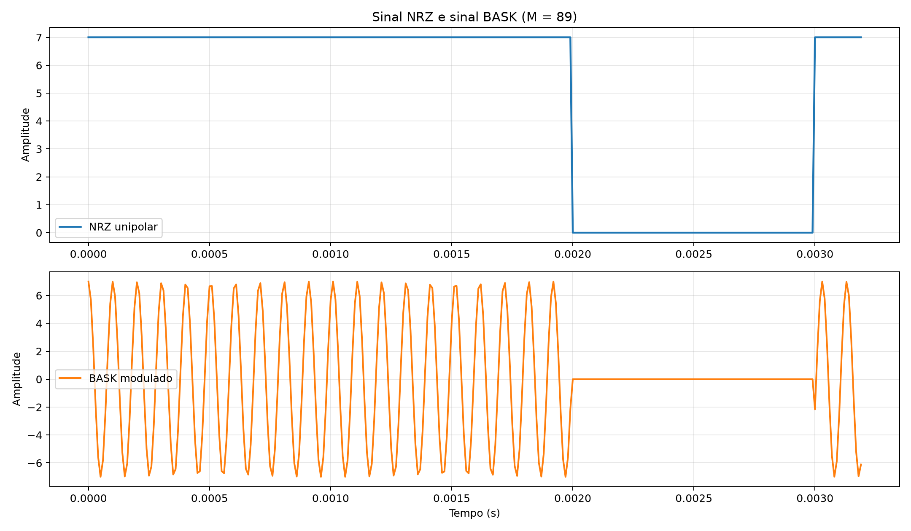
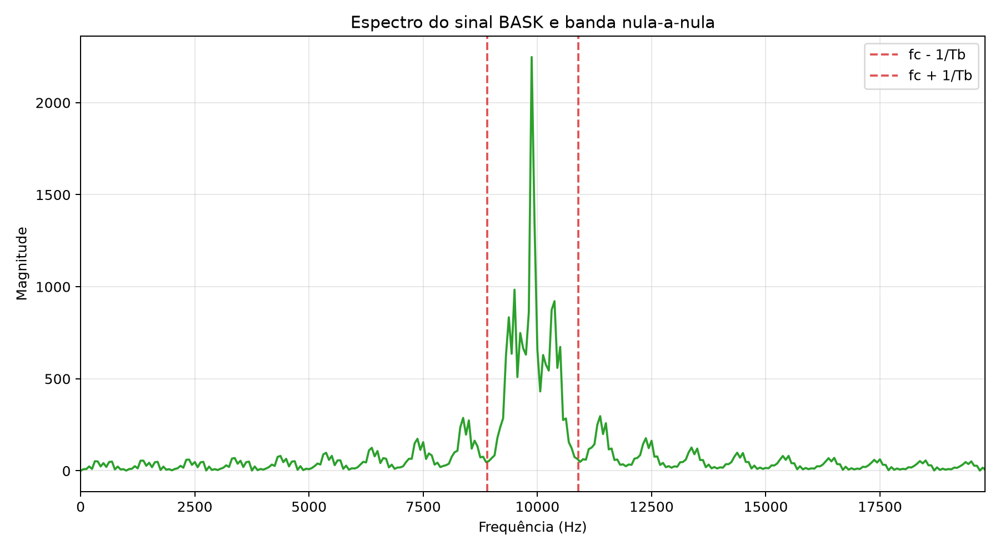
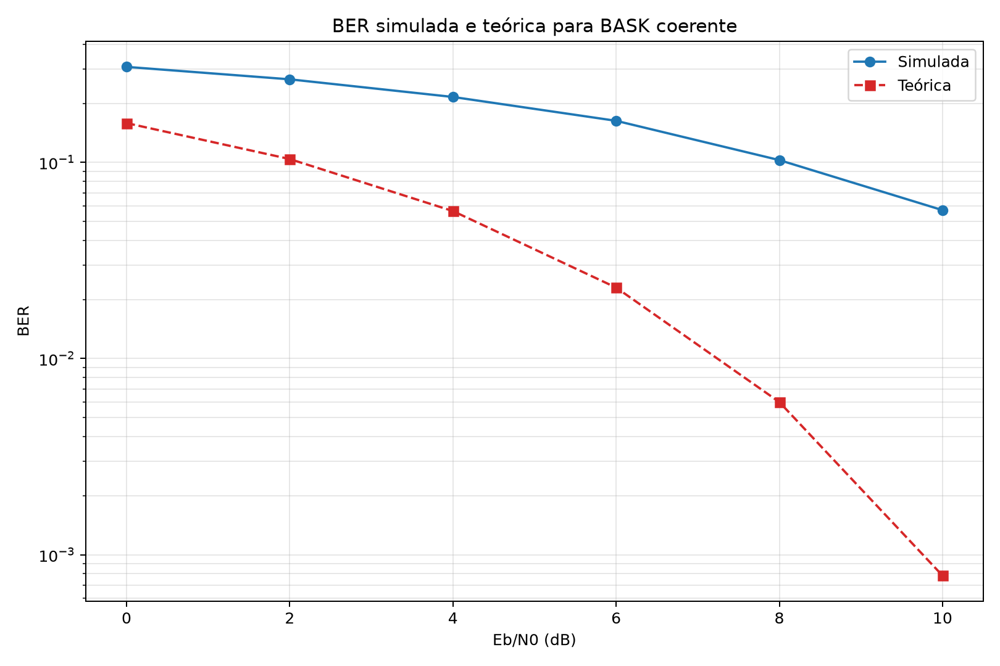

# Atividade 4: Simulação ASK (BASK) com detecção coerente

**Tema:** modulação digital ASK/BASK, detecção coerente, espectro e BER

## Resumo executivo

A atividade foi desenvolvida para implementar, em simulação, um sistema de comunicação digital em banda passante usando modulação ASK binária (BASK). O sinal foi gerado a partir de uma sequência de bits NRZ unipolar, multiplicada por uma portadora cossenoidal e, em seguida, submetida a um receptor coerente com correlação e limiar de decisão. A análise foi feita em três etapas: (i) dedução teórica do limiar e da largura de banda esperada, (ii) implementação do transmissor e do receptor e (iii) avaliação do efeito do ruído AWGN na taxa de erro de bit. Os resultados mostraram que a forma de onda modulada reproduz corretamente a ideia da ASK binária e que o limiar deduzido pelo critério de decisão mínimo erro produz decodificação correta em ausência de ruído. Os valores históricos de BER apresentam discrepância com a referência teórica, discutida na Seção 6.

## 1. Parâmetros individuais

Os parâmetros foram definidos conforme o roteiro do notebook e a matrícula usada para a simulação foi escolhida como o exemplo do documento:

- M = 89
- fc = 1000 + 100 × M = 9900 Hz
- A = 3 + (M % 5) = 7 V
- seed = 89
- Tb = 1/Rb com Rb = 1000 bps, logo Tb = 1 ms
- fs = 100 kHz

Esses valores garantem uma sequência pseudoaleatória reproduzível e uma portadora suficientemente elevada para permitir a recuperação coerente do sinal.

## 2. Dedução teórica

### 2.1 Energia por bit do esquema BASK

No esquema BASK binário com NRZ unipolar, a onda correspondente ao bit 1 é:

> s1(t) = A cos(2πfct),    0 ≤ t < Tb

e o bit 0 é representado por amplitude nula:

> s0(t) = 0

A energia do bit 1 é:

> E1 = ∫0Tb A² cos²(2πfct) dt = A² ∫0Tb (1 + cos(4πfct))/2 dt

A aproximação despreza o termo de fronteira da integral. Com fcTb = 9,9, o intervalo contém um número fracionário de ciclos, portanto o cancelamento não é exato.

> E1 = A² Tb / 2

Assim, para o esquema em questão:

> E1 ≈ A² Tb / 2 = 7² × 10-3 / 2 = 0,0245 J

### 2.2 Limiar de decisão

No receptor coerente, o correlator multiplica o sinal recebido pela portadora de referência e integra por intervalo de bit. Para bit 1, a saída esperada é:

> y1 = ∫0Tb A cos²(2πfct) dt = A Tb / 2

Para bit 0, como o sinal é nulo:

> y0 = 0

O limiar ótimo para sinais equiprováveis é o ponto médio entre as duas saídas esperadas:

> Vth = (y1 + y0) / 2 = A Tb / 4

Com os valores da simulação:

> Vth = 7 × 10-3 / 4 = 1,75 × 10-3 V·s

Esse foi o limiar usado na decisão do receptor.

### 2.3 Largura de banda nula-a-nula

Para um sinal BASK com NRZ unipolar, a envelope do espectro ocupa uma faixa aproximadamente dada por:

> B ≈ 2/Tb

Como Tb = 1 ms, temos:

> B ≈ 2 / 10-3 = 2000 Hz

Isso significa que a energia principal do sinal modulado se concentra em torno da portadora no intervalo:

> fc ± 1/Tb

logo, a banda nula-a-nula do envelope é aproximadamente 2 kHz.

## 3. Implementação do sistema BASK

A sequência de bits gerada foi:

1101010011010101

A forma de onda NRZ unipolar foi construída com amplitude A para bit 1 e zero para bit 0, e a portadora foi:

> s(t) = b(t) × A cos(2πfct)

A demodulação foi feita por correlação coerente: o receptor multiplicou o sinal recebido pela mesma portadora de referência e integrou por intervalo de bit. A decisão final foi feita com o limiar deduzido teoricamente:

> Vth = A Tb / 4

Neste caso, a detecção em canal ideal produz uma reconstrução perfeita da sequência de bits, como esperado para um sistema sem ruído e sem desalinhamento de portadora.

## 4. Resultados no domínio do tempo e na frequência

A figura acima mostra a sequência de bits NRZ aplicada ao modulador e a onda BASK resultante. O bit 1 aparece como uma porção da portadora em fase com amplitude A; o bit 0 corresponde à ausência de portadora.

Na figura do espectro, observa-se que a potência do sinal está concentrada em torno de fc e que os limites da banda principal, em torno de fc ± 1/Tb, estão compatíveis com a previsão teórica de 2/Tb. Em outras palavras, o espectro obedecia ao comportamento esperado de um sinal ASK binário em banda passante.

## 5. Canal com ruído AWGN e BER

Para analisar o desempenho em presença de ruído, adicionou-se ruído gaussiano ao sinal de decisão do correlator. A relação sinal-ruído foi variada em Eb/N0 e a taxa de erro de bit foi comparada com a curva teórica de BASK coerente.

Para bits equiprováveis, a energia média é Eb = E1/2 ≈ 0,01225 J. Nessa convenção, a BER coerente é

> Pb = Q(√(Eb/N0))

Com os parâmetros da simulação:

> E1 ≈ A² Tb / 2 = 2,45 × 10-2 J

A curva obtida foi:

Os valores principais foram:

- Eb/N0 = 6 dB: BER teórica ≈ 2.301e-02; BER simulada ≈ 1.630e-01
- Eb/N0 = 10 dB: BER teórica ≈ 7.827e-04; BER simulada ≈ 5.710e-02

## 6. Discussão

A recuperação ideal pressupõe sincronismo entre a referência e a portadora. O correlator deve usar a fase correspondente a cada janela, sobretudo porque fcTb = 9,9.

Os valores de BER armazenados no relatório são 0,163 a 6 dB e 0,0571 a 10 dB, frente a 0,02301 e 0,0007827 na referência. A diferença excede uma simples flutuação estatística. O gerador histórico usa energia do estado ligado como Eb e uma variância de ruído de decisão incompatível com a normalização teórica. A curva registra uma inconsistência de implementação que precisa ser resolvida antes de afirmar validação quantitativa.

## 7. Conclusão

A atividade ilustra a representação liga/desliga da portadora, a decisão pelo limiar médio e a largura principal aproximada de 2 kHz. A comparação quantitativa da BER permanece limitada pela normalização da energia e do ruído no gerador histórico.
