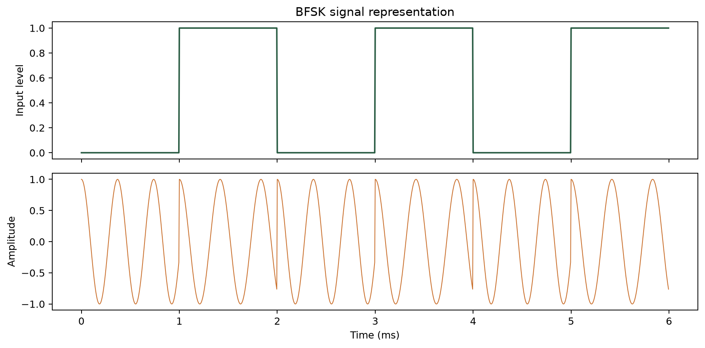
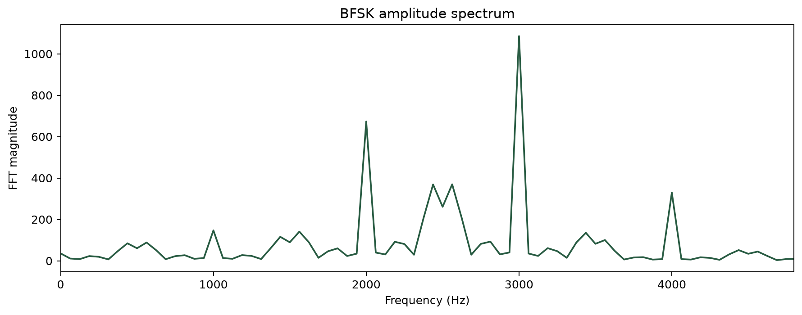
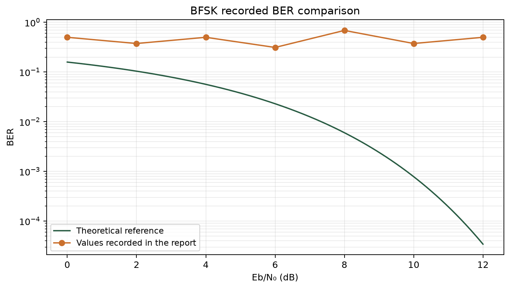

# Activity 05 - Coherent binary frequency-shift keying

This activity represents each bit by one of two carrier frequencies and recovers the information using two correlators. The study examines tone spacing, waveform generation and the recorded AWGN results.

## Executive summary

The transmitter selects a tone for each bit, and the receiver compares projections onto the two references. The selected frequencies are separated by 310 Hz over a 1 ms bit interval.

The historical BER calculation used only 16 bits per point and inconsistent signal-energy and noise scaling. The recorded values are presented with those limitations.

## 1. Individual parameters

| Parameter | Value |
|---|---|
| Individual parameter used | 89 |
| First frequency f₁ | 2,400 Hz |
| Second frequency f₂ | 2,710 Hz |
| Frequency separation | 310 Hz |
| Bit interval Tb | 1 ms |
| Reference separation 1/(2Tb) | 500 Hz |
| Separation factor | 0.62 |
| Bit sequence | 0101010101001010 |

The 500 Hz value is the familiar coherent orthogonal-tone spacing under compatible phase and frequency conditions. For a specific pair of finite-duration tones, orthogonality must be checked from their inner product.

## 2. Coherent BFSK model

Each bit selects a cosine segment at f₁ or f₂. The implementation uses √Eb cos(2πft) over each bit interval and restarts the time reference within that interval.

The correlator outputs are proportional to

> x₁ = ∫r(t) cos(2πf₁t) dt
> x₂ = ∫r(t) cos(2πf₂t) dt

The receiver decides one when x₁ exceeds x₂ and zero otherwise.

For equal-energy orthogonal BFSK in AWGN, coherent detection gives

> Pb = Q(√(Eb/N₀))

This expression assumes that Eb is the actual energy of each transmitted bit waveform.

## 3. Transmitter

The recorded sequence is 0101010101001010. Bit one selects f₁ and bit zero selects f₂. The individual segments are concatenated to form the transmitted record.

The information is carried by tone selection. The receiver needs a phase-consistent reference for each segment.

## 4. Correlation receiver

Two reference branches integrate the received waveform over Tb. The decision statistic is y = x₁ − x₂.

In a correctly normalized equal-energy model, the sign of this difference identifies the more likely waveform. When tones are not orthogonal, each branch also responds to part of the other tone.

## 5. Frequency-domain result

The finite bit windows broaden the tone spectra. With a separation of 310 Hz, the tones are closer than the 500 Hz reference spacing used in the activity. The resulting overlap must be considered when interpreting the correlator outputs.

## 6. AWGN and recorded BER

| Eb/N₀ | Recorded simulated BER | Orthogonal reference |
|---|---|---|
| 0 dB | 0.5000 | 0.1587 |
| 2 dB | 0.3750 | 0.1040 |
| 4 dB | 0.5000 | 0.0565 |
| 6 dB | 0.3125 | 0.0230 |
| 8 dB | 0.6875 | 0.0060 |
| 10 dB | 0.3750 | 0.0008 |
| 12 dB | 0.5000 | approximately 0.000034 |

Each simulation point used only 16 bits. The smallest nonzero measurable BER is therefore 1/16 = 0.0625.

## 7. Discussion

The tone spacing does not satisfy the chosen orthogonal reference condition. However, that difference alone cannot explain the entire BER discrepancy.

The generator multiplies the cosine by √Eb without normalizing its energy over Tb. With Eb set to one and Tb = 1 ms, the waveform energy is of order 0.0005 J. The noise routine nevertheless treats the bit energy as 1 J. The resulting noise scale is inconsistent with the actual signal.

Consequently, the BER values near 0.5 cannot be interpreted as a clean measurement of the tone-spacing penalty. The signal energy, noise density and reference inner products must be consistent before comparing the curve with theory.

## 8. Conclusion

The activity demonstrates frequency selection and two-branch correlation. The stored BER result exposes an energy-normalization and sample-size limitation. It does not quantitatively validate the orthogonal BFSK formula.

The numerical values and figures above come from the existing activity. The interpretation has been revised to state the limitations of those results.
