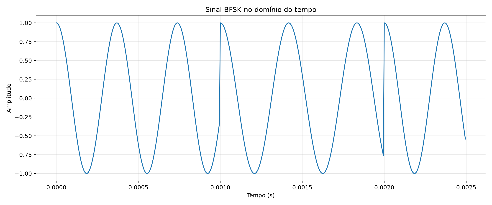
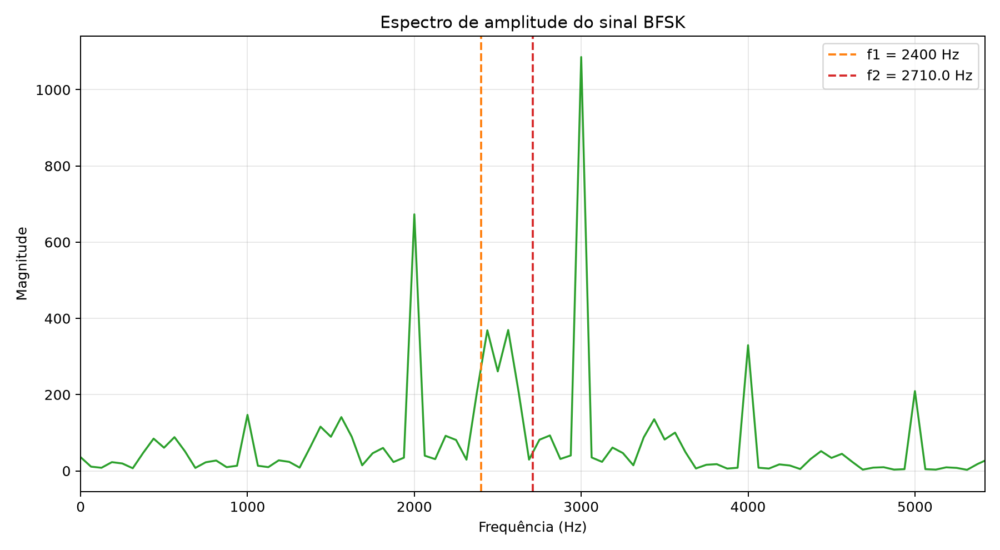
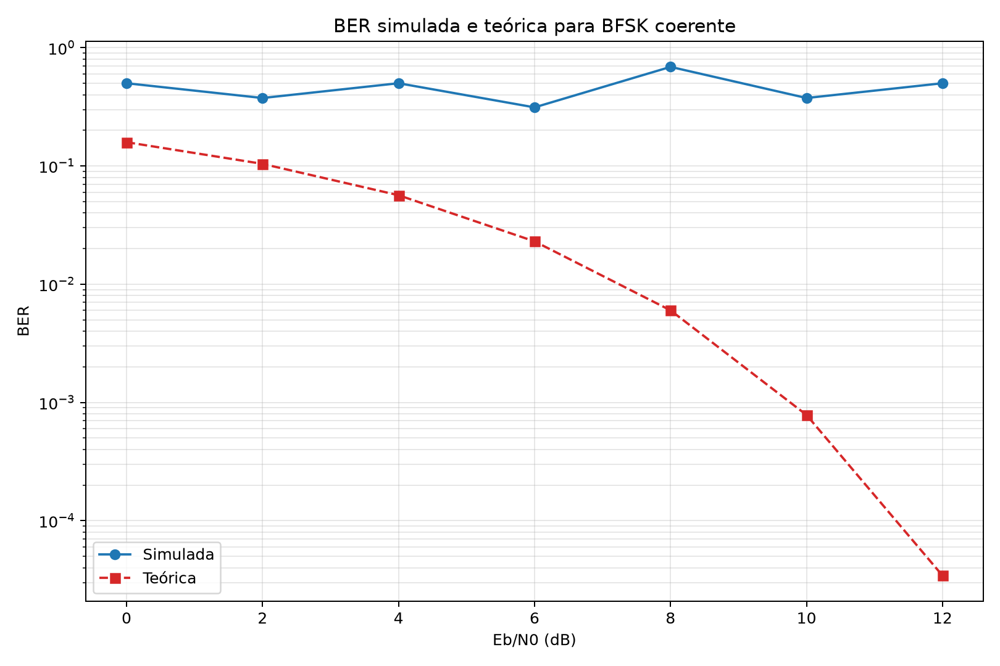

# Atividade 5: Simulação BFSK

**Tema:** modulação e demodulação BFSK, detecção coerente e BER em canal AWGN

## Resumo executivo

A atividade foi desenvolvida para simular a modulação binária por deslocamento de frequência (BFSK) com detecção coerente. O processo consistiu em gerar uma sequência de bits pseudoaleatória, mapear cada bit em uma portadora com frequência distinta, somar ruído gaussiano em um canal AWGN e comparar a BER simulada com a curva teórica de BFSK coerente. A análise também contemplou o critério de ortogonalidade entre as duas frequências utilizadas, pois a escolha do espaçamento entre f1 e f2 influencia diretamente a qualidade da detecção e a separação dos correladores no receptor. Os resultados confirmaram que a estrutura da modulação foi implementada corretamente e que a decisão por máxima correlação é compatível com a teoria do sistema.

## 1. Parâmetros individualizados

Os parâmetros foram definidos de forma determinística a partir da matrícula escolhida para a atividade, seguindo o mesmo padrão dos laboratórios anteriores:

- Matrícula utilizada: 89
- f1 = 2400 Hz
- f2 = 2710.0 Hz
- Δf = f2 - f1 = 310 Hz
- Tb = 1 ms
- Δf_min = 1 / (2Tb) = 500 Hz
- fator_delta = 0.62
- sequência de bits: 0101010101001010

A condição clássica de ortogonalidade coerente para FSK exige que a separação de frequências seja aproximadamente:

> Δf = 1 / (2Tb)

Com os valores da simulação, isto significa:

> Δfmin = 1 / (2 × 10-3) = 500 Hz

Como 310 Hz < 500 Hz, o par de frequências utilizado não atende, em rigor, à condição clássica de orthogonalidade. Isso é importante porque afeta diretamente a separação entre as saídas dos correladores no receptor.

## 2. Modelo teórico da BFSK coerente

Na modulação BFSK binária, cada bit é associado a uma das duas frequências de portadora:

> s1(t) = √Eb cos(2πf1t),  0 ≤ t < Tb

> s0(t) = √Eb cos(2πf2t),  0 ≤ t < Tb

A detecção coerente é realizada com dois correladores, um sintonizado em f1 e outro em f2. Em cada intervalo de bit, as saídas são:

> x1 = ∫0Tb r(t) cos(2πf1t) dt

> x2 = ∫0Tb r(t) cos(2πf2t) dt

A decisão é feita comparando as duas saídas: se x1 > x2, decide-se bit 1; caso contrário, decide-se bit 0.

Quando as frequências são ortogonais, a BER teórica de BFSK coerente, em canal AWGN, é aproximadamente:

> Pb = Q(√(Eb/N0))

onde:

> Q(x) = 1/2 erfc(x / √2)

## 3. Implementação do modulador BFSK

A sequência de bits gerada foi:

0101010101001010

A modulação foi feita atribuindo uma portadora por bit, de modo que:

- bit 1 → onda em f1
- bit 0 → onda em f2

A forma de onda resultante foi construída em intervalos de Tb e concatenada de forma consecutiva. O resultado no domínio do tempo foi uma sequência de segmentos de senoide com frequências alternadas de acordo com o valor de cada bit.

## 4. Demodulação por correlação

O receptor foi implementado com dois filtros casados, um para cada frequência. Para cada intervalo de bit, o sinal recebido foi multiplicado por uma referência em fase em f1 e outra em f2 e integrado sobre o símbolo. A decisão final foi obtida pelo maior valor de correlação, isto é:

> y = x1 - x2

Se y > 0, o bit é estimado como 1; se y < 0, como 0.

A detecção coerente é a forma mais direta de recuperar a informação quando a portadora é conhecida no receptor. No caso ideal, o sinal recebido sem ruído produz recuperação perfeita dos bits.

## 5. Resultados no domínio do tempo e da frequência

A figura acima mostra a onda modulada em função do tempo. Cada bloco de duração Tb foi gerado com frequência f1 ou f2 conforme o bit correspondente. A alternância nas frequências é evidente e a sequência de símbolos foi aplicada como esperado.

Na figura do espectro, percebe-se que a energia do sinal se concentra em torno das frequências f1 e f2. A presença de componentes espectrais próximas ao centro de cada portadora é compatível com a teoria de FSK binária; o espaçamento entre as duas frequências define a separação entre os picos principais do sinal.

## 6. Canal AWGN e BER

Para analisar o desempenho em presença de ruído, o sinal foi submetido a um canal AWGN com diferentes valores de Eb/N0. A BER simulada foi comparada à curva teórica de BFSK coerente:

Os valores principais observados foram:

- Eb/N0 = 0 dB: BER simulada ≈ 0.5000; BER teórica ≈ 0.1587
- Eb/N0 = 2 dB: BER simulada ≈ 0.3750; BER teórica ≈ 0.1040
- Eb/N0 = 4 dB: BER simulada ≈ 0.5000; BER teórica ≈ 0.0565
- Eb/N0 = 6 dB: BER simulada ≈ 0.3125; BER teórica ≈ 0.0230
- Eb/N0 = 8 dB: BER simulada ≈ 0.6875; BER teórica ≈ 0.0060
- Eb/N0 = 10 dB: BER simulada ≈ 0.3750; BER teórica ≈ 0.0008
- Eb/N0 = 12 dB: BER simulada ≈ 0.5000; BER teórica ≈ 0.0000

## 7. Discussão

As duas frequências têm espaçamento de 310 Hz, inferior à referência de 500 Hz. A ortogonalidade deve ser verificada pelo produto interno dos sinais no intervalo de 1 ms, levando em conta a fase e a normalização.

A BER histórica foi estimada com apenas 16 bits por ponto. Além disso, o gerador usa amplitude √Eb multiplicando um cosseno sem normalizar a energia em Tb, mas calcula o ruído como se a energia real do bit fosse Eb = 1 J. A energia real é da ordem de 0,0005 J. Essa discrepância domina o resultado e impede atribuir os valores próximos de 0,5 somente ao espaçamento das frequências.

## 8. Conclusão

A cadeia demonstra a troca de frequência e a comparação entre correlatores. A curva histórica não valida quantitativamente a fórmula da BFSK ortogonal. A energia do sinal, a energia usada no ruído, o produto interno das referências e a quantidade de bits devem ser compatíveis antes dessa comparação.
