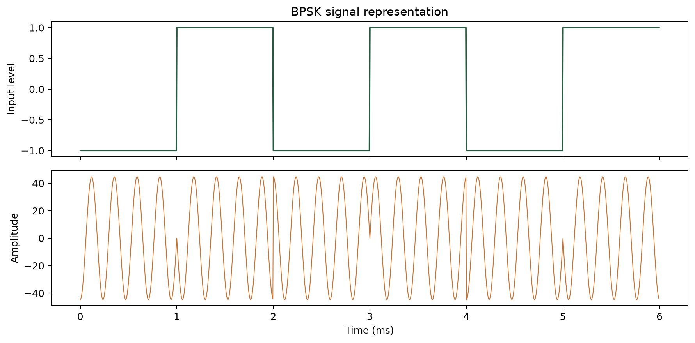
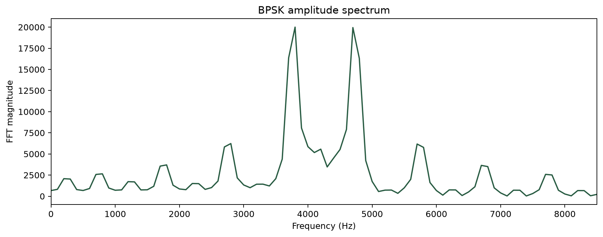
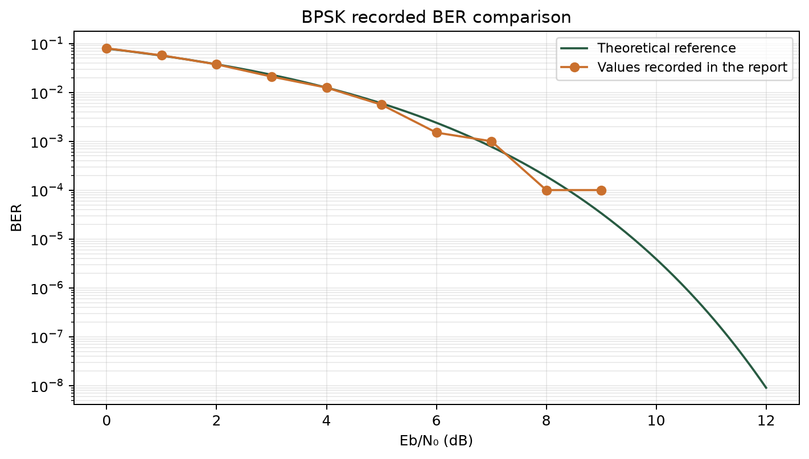

# Activity 06 - Coherent binary phase-shift keying

This activity implements BPSK modulation, coherent correlation and an AWGN performance comparison. Bits select opposite carrier phases, and the receiver uses the sign of the final correlation output.

## Executive summary

The bit sequence is mapped to polar levels and multiplied by a cosine reference. In the ideal channel, the receiver recovers every bit. The recorded BER decreases with increasing Eb/N₀ and broadly follows the coherent BPSK reference.

The fractional number of carrier cycles produces a small variation in the sampled reference energy. A separate bandwidth calculation in the historical script was found to be unsuitable for estimating 99% occupied bandwidth.

## 1. Individual parameters

| Parameter | Value |
|---|---|
| Parameter used to generate the sequence | 89 |
| Carrier frequency | 4,250 Hz |
| Bit interval | 1 ms |
| Carrier cycles per bit | 4.25 |
| Bit sequence | 0101010101 |
| Sample rate | 200 kHz |

The receiver uses the same carrier frequency and phase as the transmitter. The bit decision is based on the polarity of the correlation output.

## 2. Coherent BPSK model

The two waveforms have opposite signs.

> s₁(t) = +√Eb φ₁(t)
> s₀(t) = −√Eb φ₁(t)
> φ₁(t) = √(2/Tb) cos(2πfct)

The receiver projects the received waveform onto the reference over each bit interval.

> x₁ = ∫r(t) φ₁(t) dt

A positive result selects bit one, and a negative result selects bit zero. With an exactly unit-energy reference, the ideal values are ±√Eb.

## 3. Modulator implementation

The transmitted sequence is 0101010101. The first stage maps a one to +√Eb and a zero to −√Eb. The second stage multiplies that level by the cosine reference.

The sign change corresponds to a 180° phase reversal. The nominal carrier envelope remains constant.

## 4. Correlation receiver

The integral is implemented as a sum of sample products multiplied by 1/fs.

> x₁ = (1/fs) Σs[n]φ₁[n]

The recorded outputs were −1.0050, +0.9950, −1.0050, +0.9950, −1.0050, +0.9950, −1.0050, +0.9950, −1.0050 and +0.9950.

Their signs reproduce the transmitted sequence exactly. The slight amplitude difference follows from the sampled reference energy in the alternating bit windows.

## 5. Spectrum

The energy is centered around the carrier. For rectangular bit pulses, the theoretical envelope has a main-lobe width of approximately 2/Tb = 2 kHz between the first nulls.

A ten-bit alternating sequence has a structured finite-record spectrum. Its detailed peaks should be distinguished from the average spectrum of a long random data sequence.

## 6. AWGN and BER

For coherent BPSK, the theoretical bit-error probability is

> Pb = Q(√(2Eb/N₀)) = 0.5 erfc(√(Eb/N₀))

| Eb/N₀ | Recorded simulated BER | Theoretical BER |
|---|---|---|
| 0 dB | 0.0796 | 0.0786 |
| 1 dB | 0.0572 | 0.0563 |
| 2 dB | 0.0374 | 0.0375 |
| 3 dB | 0.0210 | 0.0229 |
| 4 dB | 0.0125 | 0.0125 |
| 5 dB | 0.0056 | 0.0060 |
| 6 dB | 0.0015 | 0.0024 |
| 7 dB | 0.0010 | 0.0008 |
| 8 dB | 0.0001 | 0.0002 |
| 9 dB | 0.0001 | approximately 0.000034 |
| 10 dB | 0 | approximately 0.0000039 |

The generator uses 10,000 bits per point. Relative uncertainty becomes large when only a few errors occur. Zero observed errors at 10 dB does not imply a zero underlying probability.

## 7. Bandwidth interpretation

The rectangular-pulse main-lobe width is approximately 2 kHz. This is a null-to-null envelope measure.

The historical script also returned 42 kHz as a supposed 99% bandwidth. Its routine used twice an absolute frequency rather than the difference between two bounds enclosing the required spectral energy. That value is not a valid occupied-bandwidth estimate and is excluded from the physical interpretation.

## 8. Discussion

Using the same reference at the transmitter and receiver preserves the decision polarity in the ideal channel, even with 4.25 cycles per bit.

The sampled reference energy is not exactly identical in every window. This is visible in the outputs −1.005 and +0.995. The effect is small enough to preserve the bit signs in this experiment.

Coherent detection also depends on phase synchronization. A phase or frequency mismatch changes the received projection and can increase the error probability.

## 9. Conclusion

The activity demonstrates phase reversal, sign-based coherent detection and the expected decrease in BER with increasing Eb/N₀. It also illustrates why the definitions of signal energy, occupied bandwidth and finite-sample error probability need to be kept explicit.
