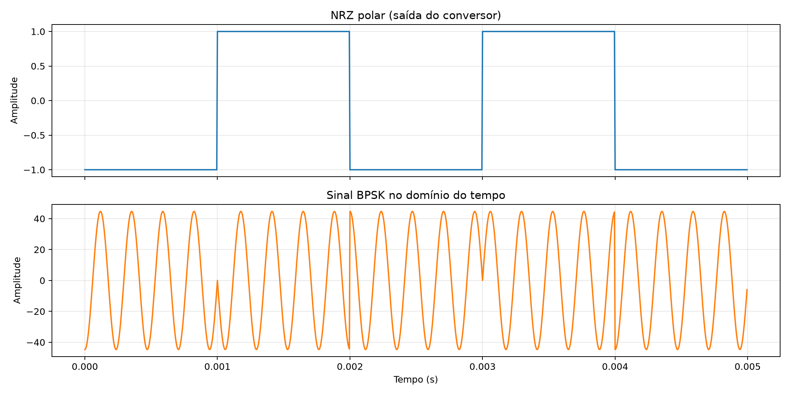
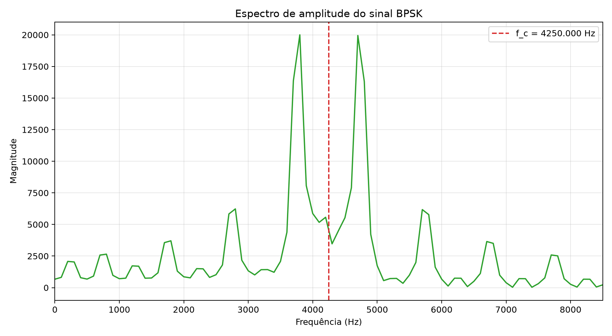
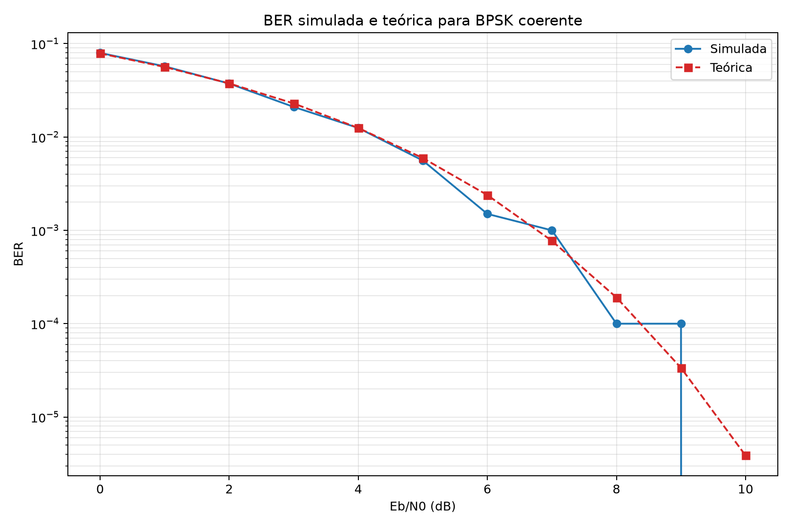

# Atividade 6: Simulação BPSK

**Tema:** modulação e demodulação BPSK coerente, correlação e BER em canal AWGN

## Resumo executivo

A atividade foi desenvolvida para simular a modulação binária por fase (BPSK), com transmissão de símbolos na forma de fase invertida em relação à portadora. O processo consistiu em gerar uma sequência binária pseudoaleatória, mapear cada bit para um símbolo com amplitude ±√E_b, multiplicar pela portadora cossenoidal e, em seguida, adicionar ruído gaussiano branco em um canal AWGN. O receptor implementou a demodulação por correlação com a mesma referência de fase da portadora, permitindo a recuperação dos bits com base na polaridade da saída do correlator. A análise comparou a BER simulada com a curva teórica da BPSK coerente e confirmou o comportamento esperado do sistema em diferentes níveis de Eb/N0.

## 1. Parâmetros individualizados

Os parâmetros foram definidos de forma determinística a partir da matrícula escolhida para a atividade, seguindo o mesmo padrão dos laboratórios anteriores:

- Matrícula utilizada: 89
- f_c = 4250.000 Hz
- T_b = 1.000e-03 s
- ciclos por bit = f_c T_b = 4.2500
- sequência de bits: 0101010101

A portadora foi escolhida com um número de ciclos por bit que pode ou não ser inteiro, e esse ponto é importante para a análise de sincronismo e de fase da referência. Em um sistema BPSK coerente ideal, a referência do receptor usa a mesma frequência e fase da portadora do transmissor, e a decisão final é baseada na polaridade de x1.

## 2. Modelo teórico da BPSK coerente

Na modulação BPSK, os dois símbolos são representados por fases opostas da portadora:

> s_1(t) = +√E_b φ_1(t),  0 ≤ t < T_b

> s_0(t) = -√E_b φ_1(t),  0 ≤ t < T_b

com

> φ_1(t) = √(2/T_b) cos(2πf_c t)

A detecção coerente é realizada por correlação com a mesma função-base. Em cada intervalo de bit, a saída do correlator é:

> x_1 = ∫_0^{T_b} r(t) φ_1(t) dt

Se x_1 > 0, decide-se bit 1; se x_1 < 0, decide-se bit 0. No caso ideal, os valores esperados de x_1 são ±√E_b, pois a energia da referência em um intervalo de bit é unitária.

## 3. Implementação do modulador BPSK

A sequência de bits gerada foi:

0101010101

A modulação BPSK foi realizada em duas etapas:

1. Conversão do bit para nível NRZ polar: bit 1 → +√E_b, bit 0 → -√E_b.
2. Multiplicação do nível NRZ pela portadora cossenoidal φ_1(t).

Assim, cada símbolo corresponde a uma fase de 0° ou 180° em relação à portadora, o que produz a inversão de fase característica da BPSK.

## 4. Demodulação por correlação

O receptor foi implementado com a mesma função-base φ_1(t), em fase com a portadora do transmissor. Para cada bit, a saída do correlator foi calculada como soma amostral sobre T_b:

> x_1 = (1/f_s) Σ s[n] φ_1[n]

Os valores observados foram:

-1.0050, 0.9950, -1.0050, 0.9950, -1.0050, 0.9950, -1.0050, 0.9950, -1.0050, 0.9950

A sequência demodulada coincidiu com a sequência original em canal ideal, o que confirma que a estrutura do receptor está correta e que a sincronização em fase foi preservada.

## 5. Resultados no domínio do tempo e da frequência

A figura acima mostra a comparação entre o sinal NRZ polar e a versão BPSK modulada no tempo. As inversões de fase são visíveis nas transições entre bits, como esperado em uma modulação por mudança de fase.

No espectro, a energia do sinal é concentrada em torno de f_c e a ocupação espectral é compatível com o modelo teórico de BPSK. A largura de banda principal está centrada em f_c e tem largura aproximada 2/T_b para os lóbulos principais.

## 6. Canal AWGN e BER

Para avaliar o desempenho em presença de ruído, o sinal foi submetido a diferentes níveis de Eb/N0. A BER simulada foi comparada com a curva teórica da BPSK coerente, dada por:

> P_b = Q(√(2E_b/N_0)) = 1/2 erfc(√(E_b/N_0))

Os valores principais observados foram:

- Eb/N0 = 0 dB: BER simulada ≈ 0.0796; BER teórica ≈ 0.0786
- Eb/N0 = 1 dB: BER simulada ≈ 0.0572; BER teórica ≈ 0.0563
- Eb/N0 = 2 dB: BER simulada ≈ 0.0374; BER teórica ≈ 0.0375
- Eb/N0 = 3 dB: BER simulada ≈ 0.0210; BER teórica ≈ 0.0229
- Eb/N0 = 4 dB: BER simulada ≈ 0.0125; BER teórica ≈ 0.0125
- Eb/N0 = 5 dB: BER simulada ≈ 0.0056; BER teórica ≈ 0.0060
- Eb/N0 = 6 dB: BER simulada ≈ 0.0015; BER teórica ≈ 0.0024
- Eb/N0 = 7 dB: BER simulada ≈ 0.0010; BER teórica ≈ 0.0008
- Eb/N0 = 8 dB: BER simulada ≈ 0.0001; BER teórica ≈ 0.0002
- Eb/N0 = 9 dB: BER simulada ≈ 0.0001; BER teórica ≈ 0.0000
- Eb/N0 = 10 dB: BER simulada ≈ 0.0000; BER teórica ≈ 0.0000

A curva simulada acompanha a tendência teórica, com pequenas diferenças estatísticas esperadas em função do número finito de bits usados na simulação.

## 7. Ocupação espectral e análise do caso prático

A largura entre nulos do lóbulo principal é aproximadamente B = 2/Tb = 2.000 Hz. Ela descreve a envoltória associada aos pulsos retangulares.

O valor histórico de 42.000 Hz obtido pela rotina de energia espectral não é uma estimativa válida da largura de banda de 99%. A rotina usa o dobro de uma frequência absoluta, em vez da diferença entre os limites de um intervalo espectral. Esse resultado foi retirado da interpretação física.

## 8. Discussão

O comportamento observado confirma a teoria da BPSK coerente: a decisão por correlação responde corretamente à fase da portadora, e a BER cresce quando o ruído aumenta. O caso em que o número de ciclos por bit não é inteiro não prejudica a demodulação por correlação em canal ideal, porque o correlator usa a mesma referência do transmissor. A energia amostral alterna ligeiramente entre janelas, como mostram os valores −1,005 e +0,995, mas a polaridade é preservada. A principal limitação prática fica mais ligada à sincronização de fase, ao erro de frequência e aos efeitos não ideais do canal do que à ausência de integridade exata do número de ciclos por bit.

A montagem também mostra que, em um sistema real, o principal desafio está na manutenção da fase e da sincronização entre transmissor e receptor. Qualquer desvio de fase constante ou de frequência tende a reduzir a projeção do sinal recebido sobre a referência e, portanto, aumenta a BER.

## 9. Conclusão

A atividade confirmou os principios da modulação BPSK coerente: a sequência de bits foi mapeada em símbolos de fase oposta, a demodulação por correlação recuperou corretamente a informação em canal ideal e a comparação com a BER teórica validou a análise em AWGN. O experimento reforça a importância da sincronização em fase e da escolha da duração de bit na definição da ocupação espectral do sistema.
