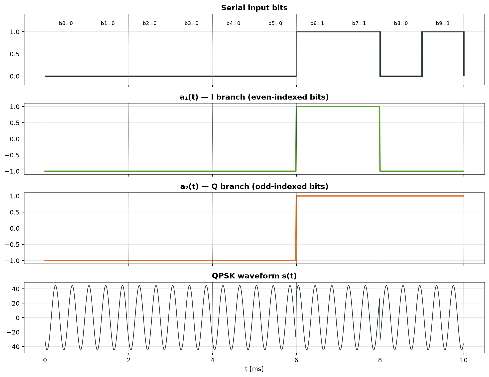
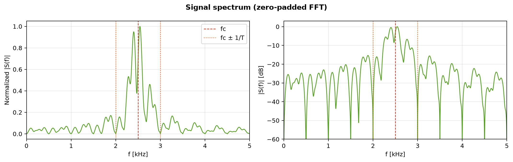
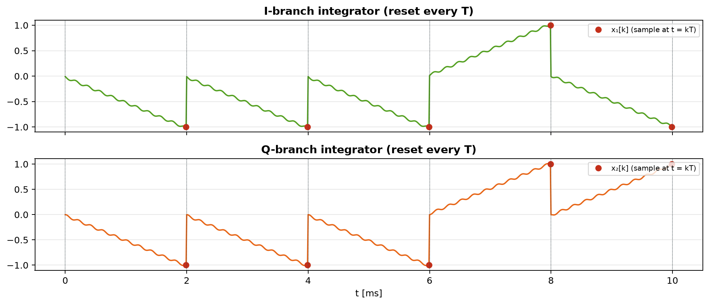
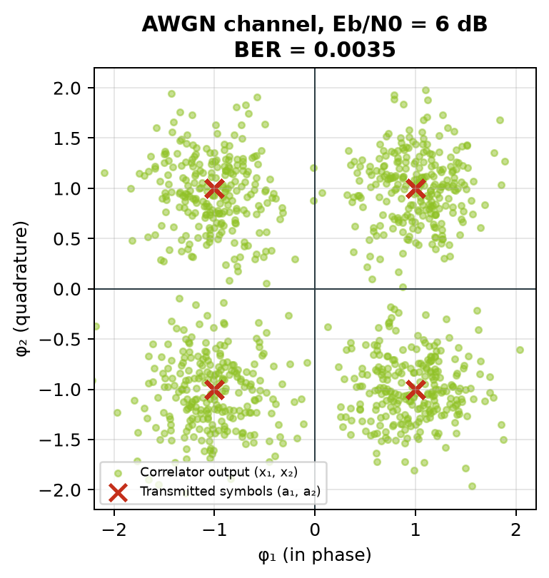

# Activity 07 - QPSK modulation and demodulation

## Executive summary

The transmitter grouped ten bits into five two-bit symbols. In the ideal channel, the correlators recovered the five I/Q coordinates and reproduced all ten bits. With AWGN at 6 dB, integrating over the complete symbol reduced the error count from 45 to 7 for the same 2,000 bits.

## 1. Time-domain modulation

The 1,000 bit/s rate gives a bit interval of 1 ms and a symbol interval of 2 ms. The 2.5 kHz carrier completes five cycles per symbol. With 1 J per bit, each coordinate is either +1 or −1. The envelope amplitude is √(4Eb/T) = 44.72, matching the sampled peak.

The groups 00 | 00 | 00 | 11 | 01 explain the two phase changes. At 6 ms, moving from (−1, −1) to (+1, +1) reverses the carrier. At 8 ms, only I changes sign and the I/Q vector rotates by another 90°.

## 2. Spectrum and coherent reception

Each branch holds its level for 2 ms. The first envelope nulls are therefore 1/T = 500 Hz from the carrier, at 2 and 3 kHz. The main-lobe width is 1 kHz. The short sequence produces ripples in the amplitude spectrum.

The receiver multiplies the signal by each basis function and sums the 200 samples within a symbol, weighted by the 10 µs sample interval. Orthogonality cancels the contribution from the other branch.

The in-phase outputs are −1, −1, −1, +1 and −1. The quadrature outputs are −1, −1, −1, +1 and +1.

Applying a zero threshold and interleaving the branch decisions gives 0000001101, the transmitted sequence. The first three symbols repeat the same phase, so the sequence occupies only three constellation positions.

## 3. Sensitivity to phase, noise and integration time

Each test used 2,000 bits. The integration-window comparison kept the bits and noise realization fixed. BER is the number of incorrect bits divided by the number transmitted.

| Test | Errors in 2,000 bits | BER |
|---|---|---|
| 1.3 or 5.3 carrier cycles per symbol, no noise | 0 in each test | 0 |
| Phase error of 30° or 44.9°, no noise | 0 in each test | 0 |
| Phase error of 45.1° or 60°, no noise | 1,000 in each test | 0.5000 |
| AWGN at 12 dB, 2 ms integration | 0 | 0 |
| AWGN at 6 dB, 2 ms integration | 7 | 0.0035 |
| AWGN at 0 dB, 2 ms integration | 164 | 0.0820 |
| AWGN at 6 dB, 1 ms integration | 45 | 0.0225 |

With a fractional carrier cycle count, one branch can contribute to the other correlator. At 1.3 cycles, the displacement is greater than at 5.3 cycles. The coordinate signs remain correct in both recorded tests.

A receiver phase error rotates the entire constellation. Beyond 45°, each point crosses into the neighboring decision quadrant.

## 4. Conclusion

At 6 dB, the theoretical QPSK BER is approximately 0.00239, consistent with the small error count observed in 2,000 bits.

Using only the first half of the symbol preserves the projection signs in the ideal test but discards half the energy. The resulting loss of approximately 3 dB explains the higher error rate with the shorter integration window.
