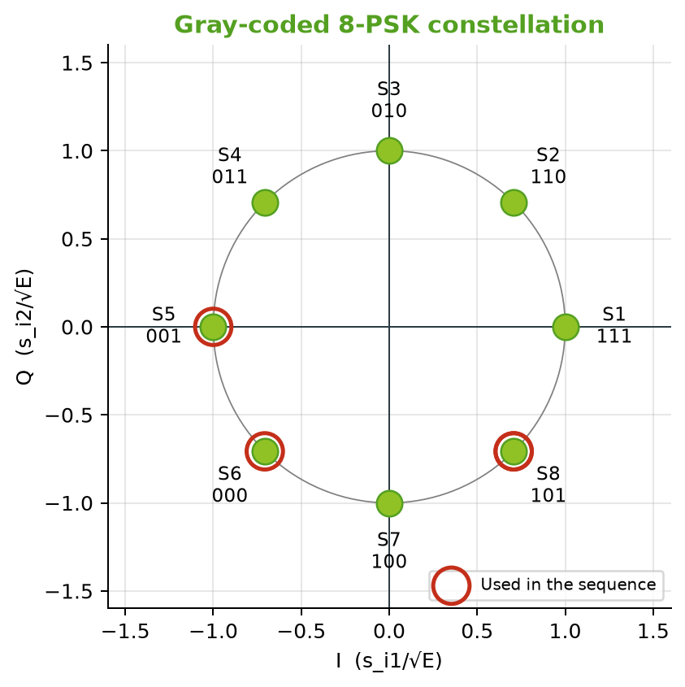
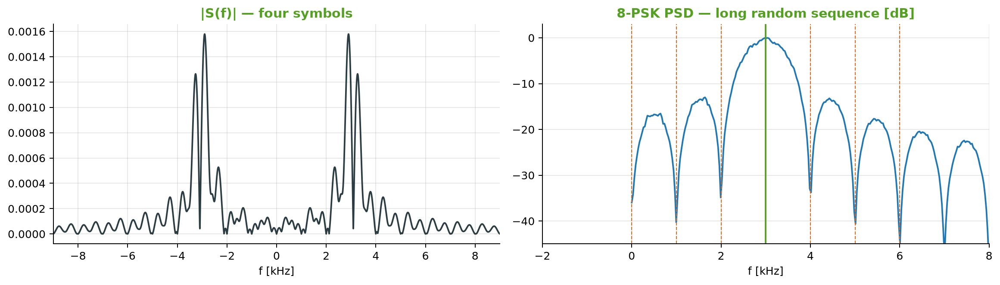
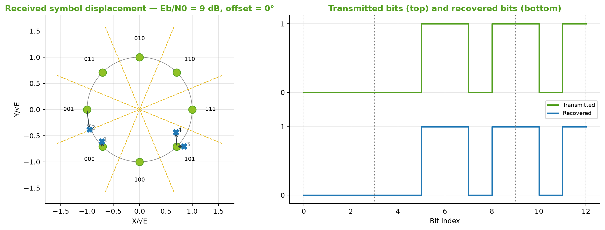
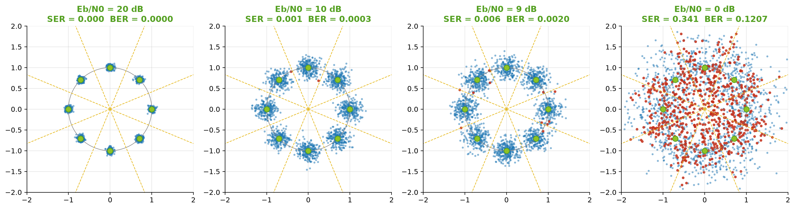
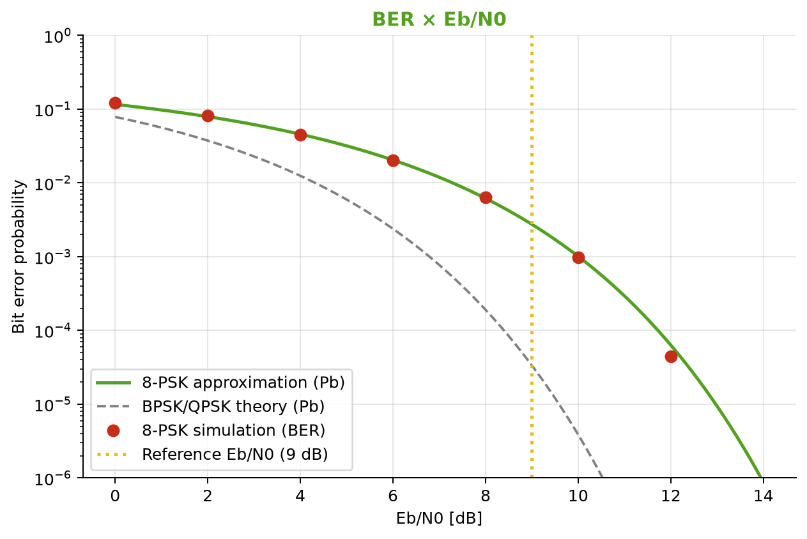
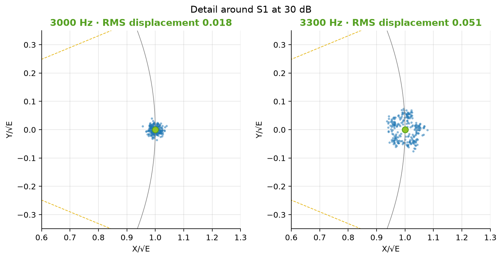

# Activity 08 - 8-PSK modulation and demodulation

## Executive summary

The transmitter sent four Gray-coded symbols in the sequence S6, S5, S8 and S8. At 9 dB, the receiver recovered all 12 bits. The second symbol had the smallest angular decision margin. Reducing Eb/N₀ to 8 dB with the same noise realization caused that symbol to be decoded as its neighbor.

## 1. Parameters and mapping

At 3,000 bit/s and three bits per symbol, the symbol rate is 1,000 baud. Each symbol lasts 1 ms and contains three cycles of the 3 kHz carrier. The envelope is 1 V, and the symbol energy is 0.0005 J for a 1 Ω load.

| Interval | Bits | Symbol | I/Q phase | I/√E | Q/√E |
|---|---|---|---|---|---|
| 0 to 1 ms | 000 | S6 | 225° | −0.7071 | −0.7071 |
| 1 to 2 ms | 001 | S5 | 180° | −1.0000 | 0 |
| 2 to 3 ms | 101 | S8 | 315° | +0.7071 | −0.7071 |
| 3 to 4 ms | 101 | S8 | 315° | +0.7071 | −0.7071 |

The distance between adjacent points is 2√E sin(22.5°) = 0.7654√E. At the three time boundaries, the I/Q phase changes are −45°, +135° and 0°. The waveform uses cos(2πfct − φ), so its phase shift has the opposite sign.

## 2. Bandwidth and phase decision

The 0.333 ms baseband NRZ pulse produces nulls at multiples of 3 kHz. Its positive mean contributes DC.

After grouping the bits, the I/Q coefficients last 1 ms. The positive-frequency main lobe extends from 2 to 4 kHz around the 3 kHz carrier.

Both basis functions have unit energy. Their inner product in the first symbol is 1.10 × 10⁻¹⁶. The correlators accumulate the projections over 1 ms.

The receiver estimates phase with atan2(Y, X) and selects the center with the smallest circular angular distance, accounting for the wrap at 360°.

| Transmitted symbol | Estimated phase | Decision | Angular margin |
|---|---|---|---|
| S6 | 220.26° | S6 | 35.51° |
| S5 | 201.79° | S5 | 1.42° |
| S8 | 320.30° | S8 | 34.41° |
| S8 | 327.88° | S8 | 19.24° |

The margin is the difference between the distances to the two closest candidate phases. The S5/S6 boundary is at 202.5°. The second estimate was only 0.71° from that boundary. At 8 dB it crossed the boundary, changing 001 to 000. Gray coding limited the neighboring-symbol error to one bit.

## 3. Noise and statistical performance

White noise produces an approximately flat spectral floor. At 0 dB, the received carrier is difficult to identify visually. Correlation benefits from accumulating information over the full symbol.

At 9 dB, the measured normalized standard deviation across the I/Q branches was 0.1475 for 2,000 symbols, close to the predicted 0.1449.

Each BER point used 30,000 symbols, or 90,000 bits. The theoretical approximation is based on nearest-neighbor errors.

At 0 dB, the simulated BER was 0.1230 against an approximate theoretical value of 0.1162. At 14 dB, no errors were observed, while the predicted BER was 8.76 × 10⁻⁷.

For BER = 10⁻⁴, the theoretical curves give approximately 11.72 dB for 8-PSK and 8.40 dB for BPSK/QPSK. The difference is 3.33 dB. At the same bit rate, 8-PSK uses two thirds of the QPSK symbol rate and corresponding pulse bandwidth.

## 4. Synchronization and sensitivity

A +20° local phase error rotates the points and reduces the nearest-boundary margin from 22.5° to 2.5°.

At 30 dB, the test observed no errors in 2,000 symbols with or without the offset. At 9 dB, SER increased from 0.0075 to 0.3865. In the ideal channel, SER was zero at 22.4° and one at 22.6°.

| Change | Reference result | Result after the change |
|---|---|---|
| Eb/N₀ from 9 to 12 dB | σ = 0.14541 | σ = 0.10294 |
| Same comparison, 90,000 bits | BER = 0.002989 | BER = 0.0000222 |
| Carrier from 3 to 3.3 kHz at 30 dB | RMS displacement = 0.0183 | RMS displacement = 0.0508 |

At 3.3 cycles per symbol, cross-projection and basis energy vary with the initial phase of each window. Several displaced centers remain visible even at high Eb/N₀.

Increasing Eb/N₀ by 3 dB reduces the noise standard deviation by a factor of approximately 0.708, matching 10^(−3/20).

## 5. Conclusion

8-PSK sends three bits per symbol while requiring tighter phase accuracy than QPSK. At fixed Eb, moving to 16-PSK reduces the nearest-neighbor distance from 1.3257√Eb to 0.7804√Eb.

At the same bit rate, 16-PSK has a 25% narrower main lobe than 8-PSK. The smaller point separation makes it more susceptible to decision errors.
