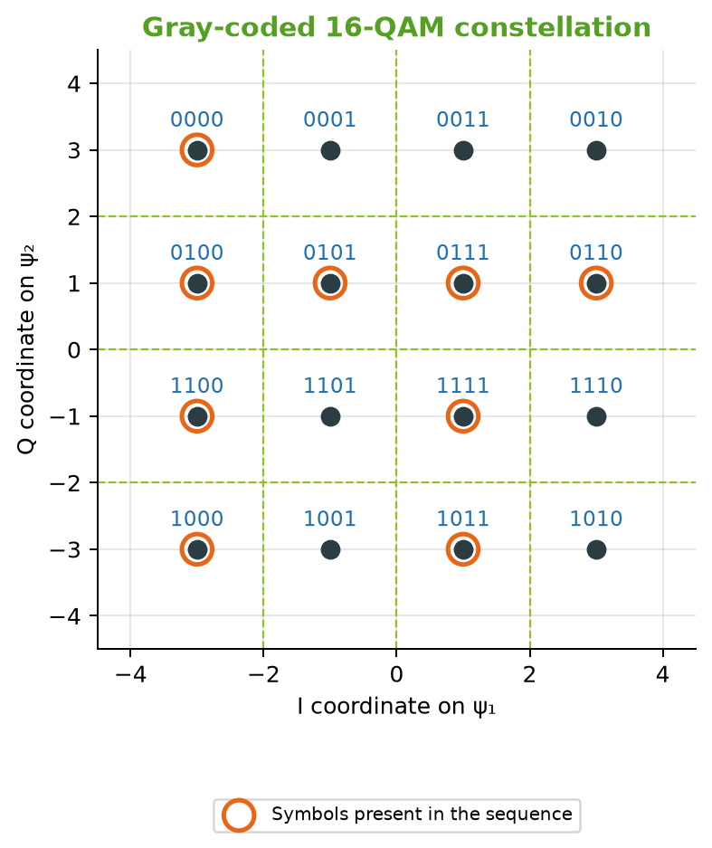
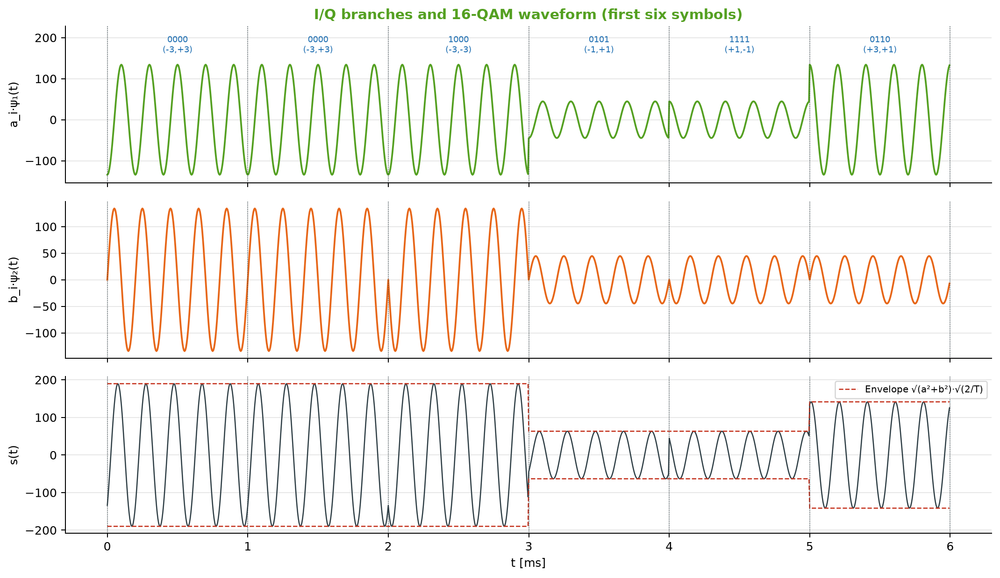
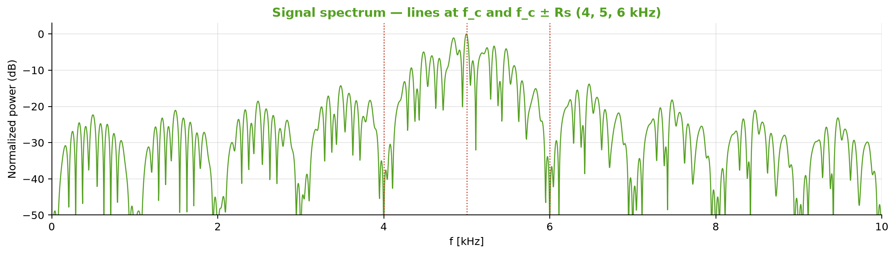
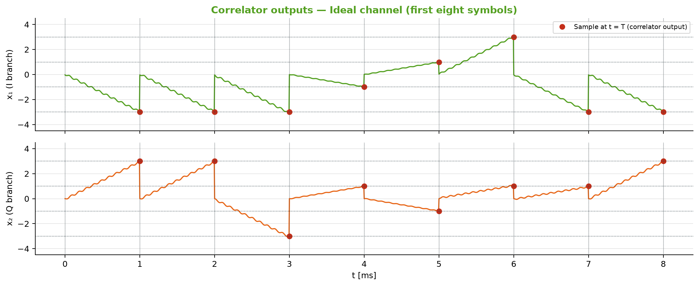
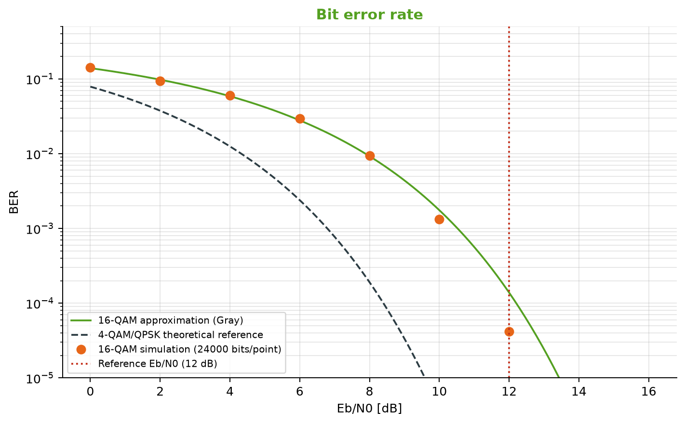
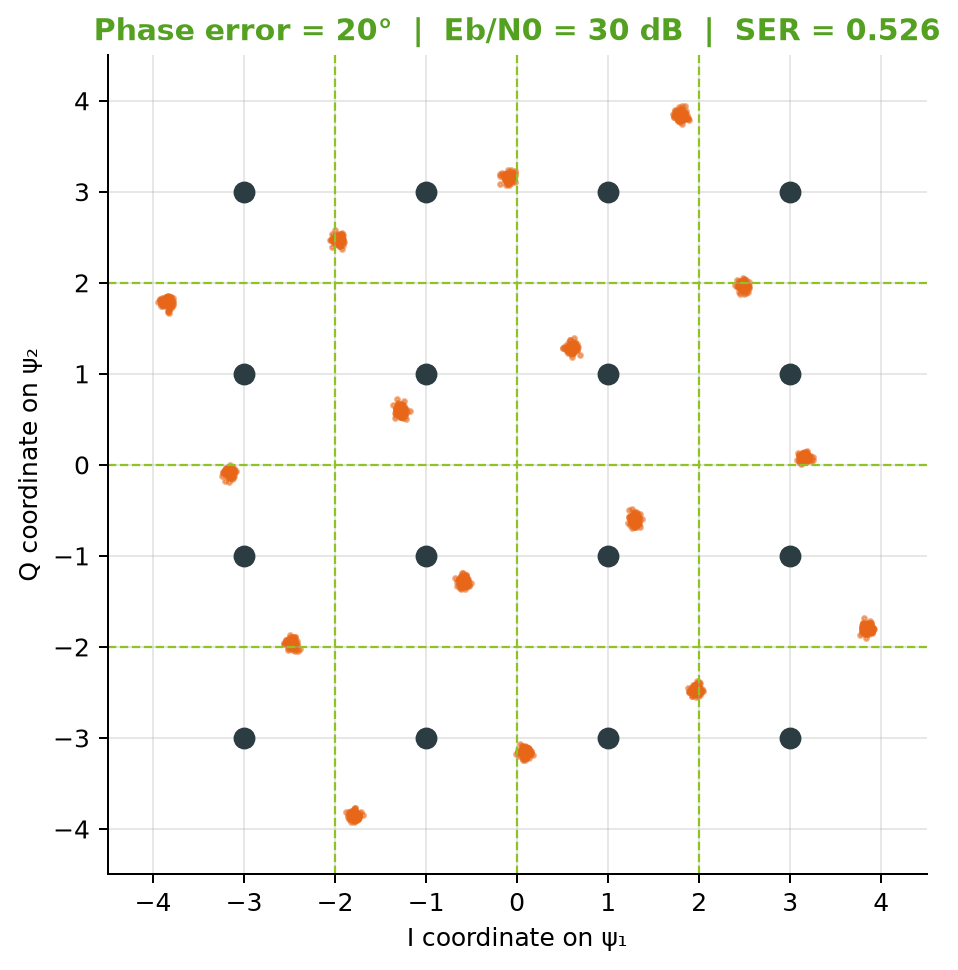

# Activity 09 - 16-QAM modulation and demodulation

## Executive summary

The 16-QAM chain transmitted 64 bits in 16 symbols using the laboratory Gray mapping. The receiver recovered every bit in the ideal channel and in the short test at 12 dB.

The activity examined the spectrum, signal energy, AWGN errors and receiver sensitivity to phase, carrier frequency and integration time.

## 1. Parameters and mapping

The symbol rate is 1 kbaud, with a 1 ms symbol interval. Four bits per symbol give 4 kbit/s and a 0.25 ms bit interval.

The 5 kHz carrier completes five cycles per symbol. Sampling at 200 kHz gives 200 samples per symbol.

| Group | I/Q coordinates | Symbol energy |
|---|---|---|
| First 0000 | (−3, +3) | 18 J |
| Second 0000 | (−3, +3) | 18 J |
| Third 1000 | (−3, −3) | 18 J |
| Fourth 0101 | (−1, +1) | 2 J |

E₀ = 1 J is the energy scale of each PAM component. The smallest QAM symbol has energy 2E₀, and the equiprobable constellation average is 10E₀.

The generated sequence had an average symbol energy of 9.50 J, confirmed by integrating signal power. The channel uses Eb = 10E₀/4 = 2.5 J as its reference.

## 2. Waveform and spectral occupancy

Each I/Q pair selects the sinusoid's amplitude and phase. For the first symbol, the radius is √18 and the vector angle is 135°.

With the laboratory normalization, the peak amplitude is 189.74. The code adds the sine branch, giving the first-symbol waveform

> s(t) = 189.74 cos(2π × 5,000t − 135°)

The pulse on each branch lasts 1 ms. The first nulls around the carrier are at 4 and 6 kHz, giving a 2 kHz main-lobe width.

The polar bit sequence has first nulls at ±4 kHz, giving a width of 8 kHz. Grouping four bits per symbol reduces the null-to-null width by a factor of four.

The unipolar sequence mean was 0.421875, and the polar mean was −0.15625. Both therefore contribute DC in this finite record.

The fluctuating part of the unipolar waveform has half the polar amplitude, corresponding to approximately 6 dB less power. Averaging several records reduces periodogram irregularity.

## 3. Correlation and decision

The numerical energy of each basis function was 1.000000, and the inner product was −9.55 × 10⁻¹⁷. Orthogonality allows each correlator to recover its coordinate after a complete symbol interval.

For 0000, the outputs are (−3, +3). The minimum-distance decision selects that point, and the inverse lookup table recovers the four bits.

All 64 bits were recovered in the ideal channel. Sampling at T/2 halved the projections. With unchanged thresholds, levels ±1.5 were decoded as ±1. The test produced 15 bit errors across ten symbols.

## 4. AWGN channel

At the 12 dB reference point, N₀ = 0.15774 and the standard deviation per axis is √(N₀/2) = 0.28084.

The nearest decision boundary is one coordinate unit away, or approximately 3.56σ. A 1,500-symbol cloud gave measured standard deviations of 0.2793 on I and 0.2704 on Q. The comparisons used the same bits and random seeds at the different noise levels.

| Eb/N₀ | Errors in 64 bits | BER in 6,000 bits |
|---|---|---|
| 20 dB | 0 | 0 |
| 12 dB | 0 | 0 |
| 10 dB | 0 | 0.001333 |
| 6 dB | 1 | 0.023500 |
| 3 dB | 7 | 0.071000 |
| 0 dB | 12 | 0.136500 |

At 3 dB, six symbols were incorrect. Five horizontal or vertical neighbor errors changed one bit each. The diagonal change 0101 → 0000 changed two bits.

Conditional SER was 0.3436 for inner points, 0.2674 for edge points and 0.1751 for corners. Those regions have four, three and two nearby decision boundaries, respectively.

## 5. BER and comparison with QPSK

The BER curve used 6,000 symbols per point, equivalent to 24,000 bits. The Gray approximation is

> Pb ≈ 0.75 Q(√(0.8 Eb/N₀))

| Eb/N₀ | Simulated BER | Approximate theoretical BER |
|---|---|---|
| 0 dB | 0.141875 | 0.139160 |
| 4 dB | 0.059875 | 0.058618 |
| 6 dB | 0.029333 | 0.027871 |
| 8 dB | 0.009375 | 0.009247 |
| 10 dB | 0.001333 | 0.001754 |
| 12 dB | 0.0000417 | 0.0001387 |
| 14 dB | 0 | 0.00000276 |

At 12 dB, one error was counted against a theoretical mean of approximately 3.33 errors in 24,000 bits. At 14 dB, the expected count is only 0.066.

With zero observed errors in that sample size, the approximate 95% upper confidence bound is 0.000125.

For BER = 10⁻³, 16-QAM requires approximately 10.52 dB and QPSK requires 6.79 dB, a difference of 3.73 dB. In exchange, 16-QAM carries twice as many bits per symbol. At the same bit rate, its null-to-null bandwidth is halved.

## 6. Sensitivity and conclusion

The product of the two basis functions oscillates at 2fc. Orthogonality is preserved when the symbol window integrates complete cycles of that product. Both 5 and 5.5 kHz therefore kept the branches separated.

A quarter-cycle addition produced cross-projection and displacement even without noise.

| Carrier frequency | Initial inner product | Maximum coordinate error |
|---|---|---|
| 5.00 and 5.50 kHz | approximately 0 | approximately 0 |
| 5.25 kHz | 0.0300 | 0.1051 |
| 40.50 kHz | approximately 0 | approximately 0 |
| 40.25 kHz | 0.0016 | 0.0197 |

A positive receiver phase offset rotates the constellation counterclockwise. At 30 dB, measured SER was zero at 5° and 10°, 0.5260 at 20° and 0.7327 at 30°.

Corner points reach the first boundary near 16.87°. Testing all 16 ideal points gave zero errors at 16° and four errors at 17°.

Doubling the symbol rate increases the main-lobe width from 2 to 4 kHz. The theoretical BER remains the same if Eb/N₀, synchronization and normalization are maintained.

Changing from Gray to natural binary increases the number of bit errors per symbol error. At 6 dB, using the same symbols and noise, BER increased from 0.02933 to 0.03867.

Changing E₀ from one to four doubles physical point distances and quadruples energy. With N₀ fixed, this gives an effective increase of 6.02 dB.

The activity connects spectral efficiency with signal energy and receiver precision. Complete calculations and the AI assistance record are available in the executed notebook.
