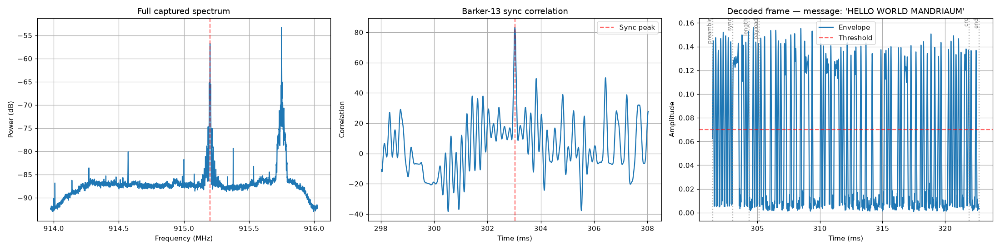
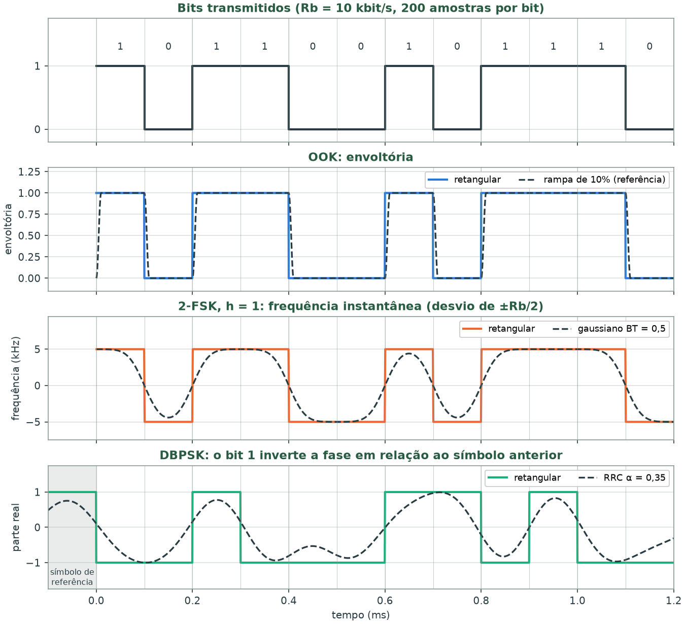
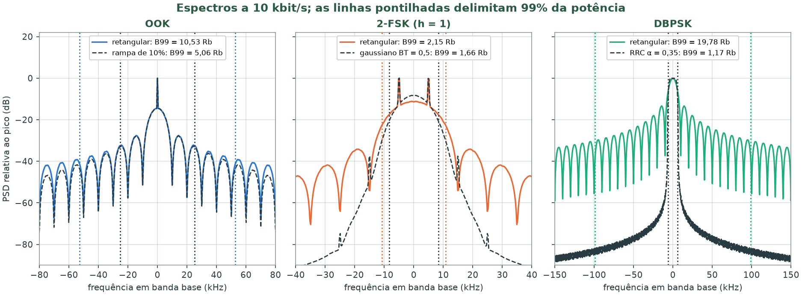
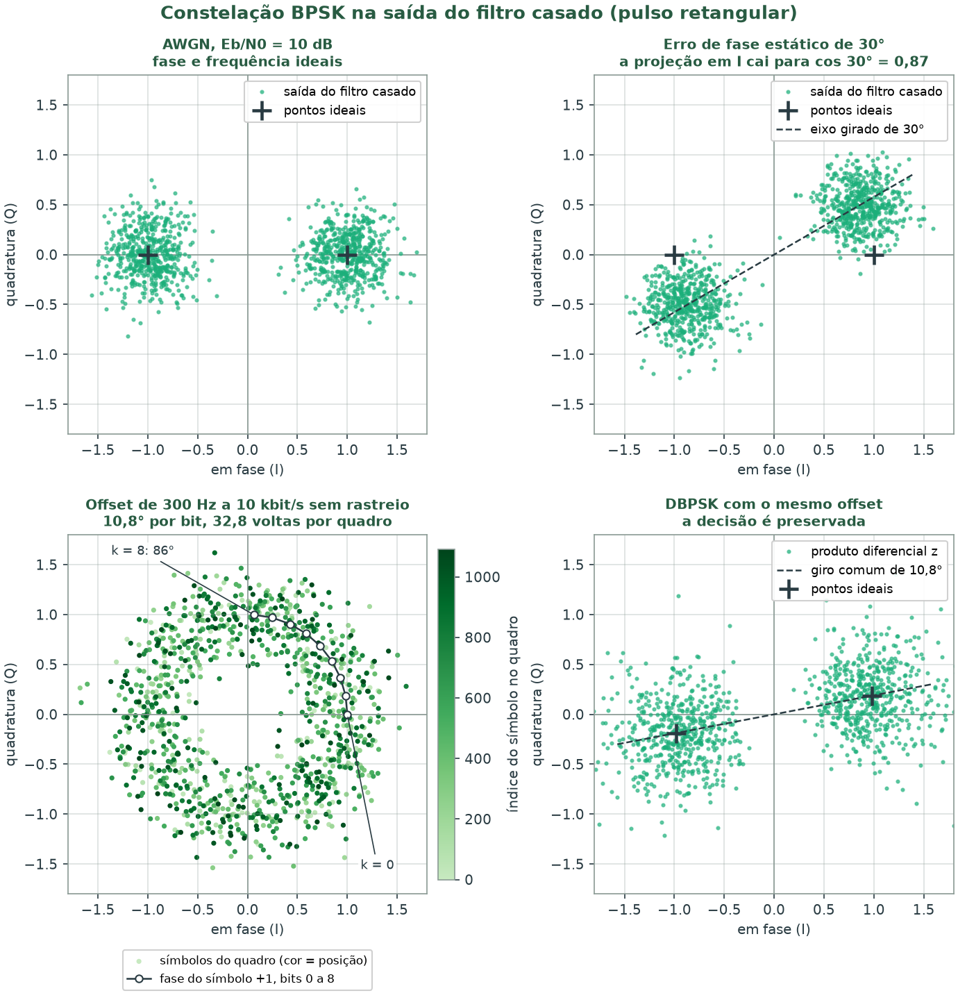
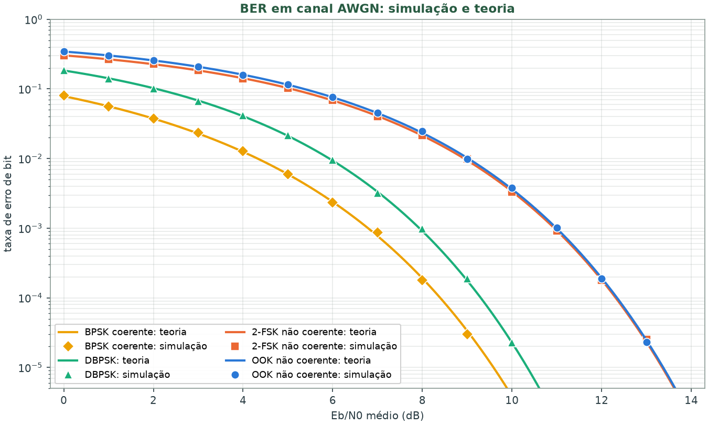
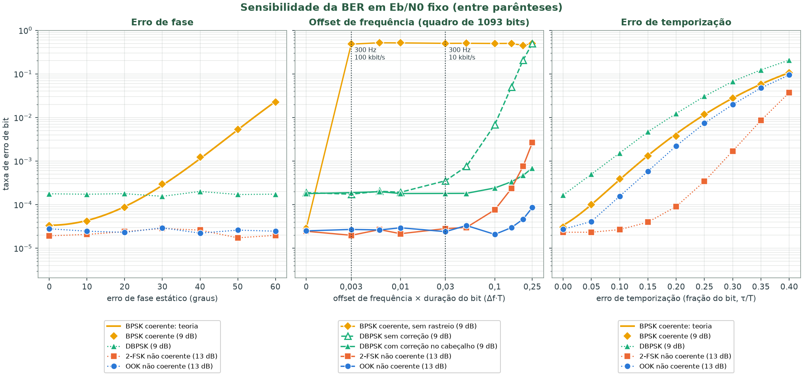
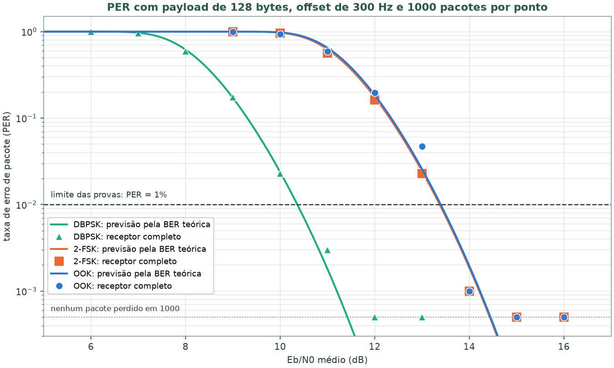
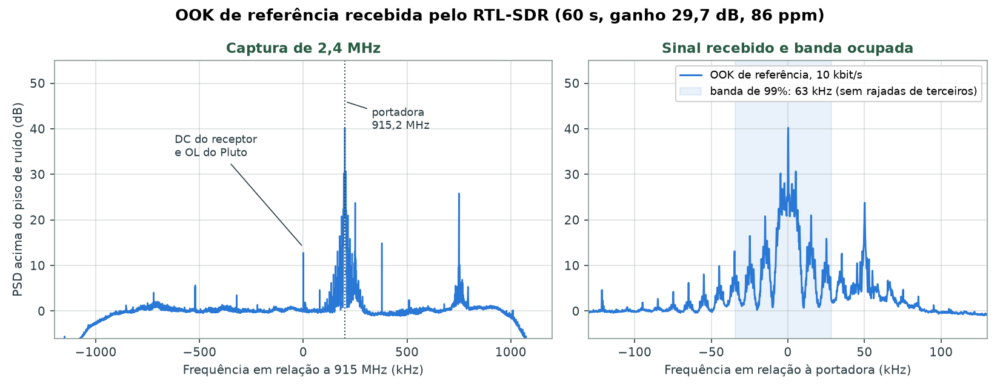
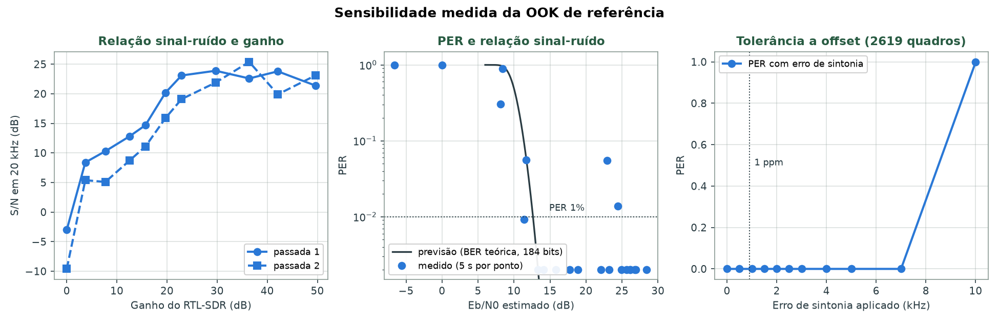

# Final project - SDR communication link

## Executive summary

The project starts from a working OOK link between an ADALM-Pluto and an RTL-SDR. It asks for 2-FSK and BPSK, packets with a sequence number, and measurements of PER, goodput, BER and occupied bandwidth. This interim report covers stages 1 to 4 and the part of stages 5 and 6 that could be measured with the reference transmitter on the air.

The reference OOK link was audited, run and measured. In a 60 s capture the project receiver recovered 2,619 of 2,619 frames, with a goodput of 7,333 bit/s for the 21-byte payload of the example. Calibration found 56 ppm on one RTL-SDR and 86 ppm on the other, while the delivered code uses 34 ppm. With 34 ppm the reference receiver decodes no frame on these devices.

The 2-FSK and DBPSK modems, the frame with sequence number and CRC-16, and the packet receiver work in simulation and on synthetic captures in the RTL-SDR file format. A PER of 1% needs an Eb/N0 of 10.4 dB for DBPSK and 13.3 to 13.4 dB for 2-FSK and OOK. The new modulations have not yet been transmitted by the Pluto, so the comparison between simulation and measurement exists only for OOK.

## 1. Audit of the reference OOK link

The transmitter builds a frame, converts the bits into an envelope and multiplies it by a 200 kHz complex carrier. The Pluto repeats this buffer continuously at 915 MHz, which places the signal at 915.2 MHz, away from the receiver DC component. The receiver captures 0.5 s, shifts the signal down by 200 kHz, filters it, extracts the envelope and looks for a single frame.

| Block | Function in the code | What it does |
|---|---|---|
| Frame | build_frame_bits | 1010... preamble, Barker-13, length, payload and CRC-8 |
| Envelope | build_ook_envelope | 200 samples per bit, 20-sample ramp at transitions |
| Capture | capture_chunks | Synchronous reads of 262,144 samples |
| Filter | simple_lowpass | 2,705-tap FIR, ±10 kHz, then 903 taps |
| Synchronization | np.correlate | Envelope correlated with Barker-13, maximum peak |
| Threshold | preamble_levels | Midpoint between the 1 and 0 levels of the known preamble |
| Decision | read_bits | Envelope average over each bit, 204.8 samples per bit |
| Validation | crc8 | Polynomial 0x07, computed over the payload only |

Reading the code raised six points that guide the rest of the project.

- The ppm value is fixed at 34 and applies to one specific dongle. Each ppm shifts the signal by 915 Hz, and the ±10 kHz filter no longer contains the carrier at about 11 ppm of error.
- The receiver decodes one frame per run. A correlation maximum always exists, even without a signal, so the CRC-8 becomes the only barrier against a false frame.
- The length field is not covered by the CRC. An error in this field changes how many bits are read.
- The search reserves room for a 64-byte payload, less than the 128 bytes used in the trials.
- There is no clock recovery. With 50 ppm oscillators the slip over a 1,085-bit frame is 0.05 bit, small enough for reading at the nominal rate.
- The message is converted to ASCII, which rules out arbitrary binary payloads.

The reference frame with 128 bytes has 1,085 bits. At 10 kbit/s it lasts 108.5 ms and delivers at most 9,438 bit/s. This confirms the remark in the assignment that the reference does not reach a goodput of 10 kbit/s.

The CRC-8 polynomial 0x07 has period 127. Two flipped bits 127 positions apart leave the CRC unchanged. A 1,032-bit word has 3,684 such pairs out of 531,996, and the test showed that none of them is detected. With random frames, the measured false acceptance rate was 0.39%.

### Running on the radios

The reference receiver was run without changing the file. Only the ppm constant was replaced in memory. The table lists the runs recorded in resultados/.

| Dongle | ppm used | Reference receiver result |
|---|---|---|
| A | 34 (original) | Length 0, received CRC 0x7f and computed 0x00, failure |
| A | 56 (calibrated) | HELLO WORLD MANDRIAUM, CRC-8 0x44, valid |
| B | 86 (calibrated) | HELLO WORLD MANDRIAUM, CRC-8 0x44, valid |

## 2. Project frame and architecture

The frame keeps the preamble and the Barker-13 word and adds a 16-bit sequence number. The check becomes CRC-16/CCITT, polynomial 0x1021, and covers length, sequence and payload. The guard interval is silence in all three modulations.

| Field | Reference | Project |
|---|---|---|
| Preamble and Barker-13 | 29 bits | 29 bits |
| Length | 8 bits | 8 bits |
| Sequence | none | 16 bits |
| 128-byte payload | 1,024 bits | 1,024 bits |
| Check | CRC-8, 8 bits | CRC-16, 16 bits |
| Guard | 16 bits | 16 bits |
| Total | 1,085 bits | 1,109 bits |
| Efficiency | 94.4% | 92.3% |

The CRC-16 costs 8 more bits per frame, 0.7% of the total. Over 1,064 protected bits, the exhaustive test of all 565,516 two-bit errors found no undetected case. False acceptance of random frames dropped to 0.0014%. A CRC-32 would lower this figure, but the gain does not justify 16 more bits while the allowed PER is 1%.

With 1,109 bits per frame, a goodput of 10 kbit/s requires at least 10,830 bit/s with zero PER and 10,940 bit/s with a PER of 1%.

The receiver uses the same chain for the three modulations. The capture is shifted to 0 Hz and resampled to eight samples per bit, an integer number. Each modulation has a detector that produces one value per sample, and the processing is common from there on.

| Modulation | Detector | Decision value |
|---|---|---|
| OOK | One-bit integration and magnitude | Envelope compared with the preamble threshold |
| 2-FSK, h = 1 | Two non-coherent correlators at ±Rb/2 | Difference of the magnitudes |
| DBPSK | Integration or matched RRC, product with the previous symbol | Real part after removing the common rotation |

Synchronization correlates this value with the 29 known bits and normalizes by the local energy. The result lies between 0 and 1 and does not depend on gain. A frame is read only when the correlation exceeds 0.6. After a valid CRC the search jumps to the end of the frame. After an invalid CRC it advances one bit.

For DBPSK the correlation is complex. Its magnitude detects the frame and its angle measures the phase rotation per bit, which is proportional to the frequency offset. This rotation is removed before the decision. For OOK and 2-FSK the offset is estimated from the phase between equal preamble bits and is used for the calibration record.

## 3. New modulations in simulation

The modulators use the reference parameters, 10 kbit/s and 200 samples per bit. Each modulation has the rectangular pulse and one alternative: a 10% ramp for OOK, a Gaussian filter with BT = 0.5 for 2-FSK and a root raised cosine with 0.35 roll-off for DBPSK.

Occupied bandwidth is the band that leaves 0.5% of the power on each side. The peak-to-average ratio matters because the Pluto converter is peak limited: a signal with 4 dB of PAPR transmits 4 dB less average power.

| Variant | 99% bandwidth | PAPR | Maximum rate in 1 MHz |
|---|---|---|---|
| Rectangular OOK | 10.53 Rb | 3.0 dB | 95 kbit/s |
| OOK with 10% ramp | 5.06 Rb | 3.1 dB | 198 kbit/s |
| Rectangular 2-FSK | 2.15 Rb | 0 dB | 465 kbit/s |
| Gaussian 2-FSK | 1.66 Rb | 0 dB | 602 kbit/s |
| Rectangular DBPSK | 19.78 Rb | 0 dB | 51 kbit/s |
| DBPSK with RRC | 1.17 Rb | 4.1 dB | 853 kbit/s |

The theoretical value for rectangular BPSK is 20.57 Rb in continuous time and 20.39 Rb with 200 samples per bit. The measurement ranged from 19.43 to 20.26 Rb over blocks of 20,000 bits, because the spectral tail is almost flat near 99%. OOK occupies about half as much because the carrier line holds half of the power. 2-FSK with h = 1 keeps a continuous phase and therefore has low sidelobes even with a rectangular pulse.

The 1 MHz rule limits rectangular DBPSK to 51 kbit/s. With RRC the limit rises to 853 kbit/s and is then set by the RTL-SDR sampling rate, which at 2.4 MS/s gives fewer than three samples per symbol at that rate.

## 4. Simulated channel

The curves use Eb/N0 defined by the average energy per bit and up to 4 million bits per point. The four simulated curves match the theoretical expressions within the statistical error.

| Scheme | Eb/N0 for BER of 0.001 | Eb/N0 for PER of 1% | Same peak power |
|---|---|---|---|
| Coherent BPSK | 6.79 dB | 9.61 dB | 9.61 dB |
| Rectangular DBPSK | 7.93 dB | 10.37 dB | 10.37 dB |
| DBPSK with RRC | 7.93 dB | 10.37 dB | 14.43 dB |
| Non-coherent 2-FSK | 10.94 dB | 13.38 dB | 13.38 dB |
| Non-coherent OOK | 10.99 dB | 13.40 dB | 16.41 dB |

A PER of 1% over 1,064 protected bits corresponds to a BER of 0.00000945. The last column adds the average power loss of each waveform when the peak is the same. OOK is off half of the time and loses 3.0 dB. DBPSK with RRC loses 4.1 dB.

### DBPSK instead of coherent BPSK

DBPSK needs 1.14 dB more than coherent BPSK at a BER of 0.001 and 0.75 dB more at the 1% PER target. In return, it needs no phase reference. A residual offset of 300 Hz at 10 kbit/s rotates the phase by 10.8° per bit. A phase reference taken at the start of the frame reaches a 90° error after 8.3 bits and completes 32.8 turns over one frame. In simulation, coherent BPSK without tracking had a BER of 0.50 with this offset, while DBPSK kept the BER of the zero-offset case.

This is the reason for the choice. Coherent BPSK would need a carrier loop able to follow hundreds of hertz within each frame, and the largest possible gain would be 0.75 dB.

| Effect | Coherent BPSK | DBPSK | 2-FSK | OOK |
|---|---|---|---|---|
| Static phase of 30° | 9 times higher | no effect | no effect | no effect |
| Offset of 0.03 Rb | BER 0.50 | 1.9 times higher | no effect | no effect |
| Offset of 0.10 Rb | BER 0.50 | BER 0.0069 | BER 0.000076 | no effect |
| Timing error of 0.1 bit | BER 0.00039 | BER 0.0015 | BER 0.000027 | BER 0.00016 |
| Timing error of 0.2 bit | BER 0.0037 | BER 0.012 | BER 0.000091 | BER 0.0022 |

The DBPSK column shows the detector without rotation correction. With the header-based correction, which is the one used in the receiver, the BER equals the zero-offset case at 0.03 Rb and rises only to 0.00024 at 0.10 Rb.

The BER values use 9 dB for BPSK and DBPSK and 13 dB for 2-FSK and OOK. An offset of 300 Hz corresponds to 0.03 Rb at 10 kbit/s and to 0.003 Rb at 100 kbit/s. Raising the bit rate reduces the effect of the same offset in hertz. 2-FSK is the most tolerant to timing error and DBPSK is the most sensitive, because the error affects two consecutive symbols.

## 5. Protocol and complete receiver

The packet simulation uses the whole receiver, with frame search, threshold and rotation estimation, field reading and CRC-16. Each point has 1,000 packets of 128 bytes at 12 kbit/s, with random delay, random phase, a 300 Hz offset and noise.

| Eb/N0 | OOK | 2-FSK | Eb/N0 | DBPSK |
|---|---|---|---|---|
| 11 dB | 0.590 | 0.565 | 8 dB | 0.595 |
| 12 dB | 0.196 | 0.163 | 9 dB | 0.174 |
| 13 dB | 0.047 | 0.023 | 10 dB | 0.023 |
| 14 dB | 0.001 | 0.001 | 11 dB | 0.003 |
| 15 dB | 0 | 0 | 12 dB | 0 |

The minimum Eb/N0 for a PER of 1% was 13.40 dB for OOK, 13.27 dB for 2-FSK and 10.41 dB for DBPSK. The prediction from the theoretical BER is 13.40, 13.38 and 10.37 dB. The implementation loss of synchronization and of reading at eight samples per bit stayed below 0.1 dB, smaller than the statistical uncertainty of about 0.2 dB. No packet was accepted with content different from what was sent. The measured goodput without losses was 11,071 bit/s, for a maximum of 11,080 bit/s.

The last test reproduces the radio chain. The signal is generated at 2 MS/s with a 200 kHz shift, resampled to 2.4 MS/s, given a 1.5 kHz carrier error and noise, and stored with 8 bits. The three modulations had zero PER over 60 packets at 20 kbit/s, and the estimated offset was 1,502, 1,495 and 1,499 Hz. The transmitter file itself was checked in a dry run for the six variants, up to 50 kbit/s with RRC.

The PER curve exposed a defect in the choice of the synchronization peak. When the threshold was crossed by a preamble sidelobe more than four bits before the peak, the frame was lost. This happened once in 25,000 packets. The search now climbs to the local maximum, and the 13 dB point for DBPSK returned to zero.

## 6. Calibration and bench measurements

The measurements used the reference transmitter on the Pluto, at 915 MHz with a gain of -20 dB, and two RTL-SDR dongles with R820T tuners at 2.4 MS/s and manual gain. Distance and antennas were not recorded. The same band carries third-party emitters that send bursts of about 30 ms and hop between 915.15, 915.20, 915.25 and 915.75 MHz.

### ppm calibration

Calibration measures the position of the carrier line with 2.3 Hz resolution, converts the error to ppm, applies the integer correction and measures the residual.

| Dongle | Error without correction | Correction | Residual offset |
|---|---|---|---|
| A | 51,112 Hz | 56 ppm | +343 Hz, 17 Hz deviation |
| B | 78,160 Hz, starting from 84 ppm | 86 ppm | +406 Hz, later +264 Hz |

The residual stayed at hundreds of hertz because the correction is an integer and 1 ppm equals 915 Hz. It also changes over time. Dongle A, just powered on, drifted from +251 to +970 Hz in 30 s. Dongle B drifted from +261 to -361 Hz in 60 s. One calibration attempt was misled by a third-party burst 50 kHz from the carrier, and the search is now limited to ±15 kHz after the first adjustment.

### 60-second trial

| Metric | Measured value |
|---|---|
| Valid frames | 2,619 of 2,619 in the interval |
| PER | 0, below 0.11% with 95% confidence |
| Goodput | 7,333 bit/s, for a maximum of 7,336 bit/s |
| Signal-to-noise ratio in 20 kHz | 24.2 dB |
| Residual offset per frame | mean of +56 Hz, deviation of 171 Hz |
| 99% bandwidth | 63 kHz without third-party bursts, 87 kHz with them |
| Processing | 7.8 s for a 60 s capture |

The goodput is low because the example sends 21 bytes per frame, with 73% efficiency. Processing uses 1.3% of the 10 minutes allowed in the trials. On dongle A, a 30 s capture had 1,308 valid frames and one lost.

The simulated 99% bandwidth for OOK with the ramp is 50.6 kHz. The measurement, without the blocks hit by bursts, was 63 kHz, 24% larger. The lower side of the measurement, free of the neighboring emitter, spans 34 kHz, against 25 kHz in simulation. The remaining difference has no confirmed cause yet. The hypotheses are residual noise after floor subtraction and the actual transmitter response.

### Sensitivity

The signal-to-noise ratio was varied through the RTL-SDR gain, in two passes of 5 s per point. Below 20 dB of gain the internal receiver noise, which does not depend on gain, dominates and the signal-to-noise ratio drops.

PER was zero at the points with at least 10 dB of signal-to-noise ratio in 20 kHz, about 13 dB of Eb/N0. At 8.4 and 8.7 dB the PER was 0.9% and 5.6%, and at 5.1 dB it was 30%. The prediction for the frame with 184 protected bits is a PER of 1% at an Eb/N0 of 12.6 dB. Measurement and prediction agree within 1 to 2 dB, which is the uncertainty of the estimated signal-to-noise ratio.

Two points depart from the trend. At 42.1 dB of gain the PER was 5.5% despite 19.9 dB of signal-to-noise ratio, and at 49.6 dB it was 1.4%, with 0.26% of the samples saturated. Between passes the signal-to-noise ratio at the same gain changed by 3 to 5 dB, which indicates a varying channel. The first sweep, with 8 s per point, was irregular and was repeated. It remains in the results file.

The tuning error was applied digitally to the 60 s capture. All 2,619 frames were recovered with up to 7 kHz of error, 7.6 ppm. At 10 kHz reception fails, because integrating over a 100 µs bit cancels a tone shifted by 10 kHz. The result did not change with 4, 8 or 16 samples per bit.

## 7. Choices for the trials and scenario analysis

The results point to starting configurations for the two categories. They depend on confirmation on the air.

- Range. Rectangular DBPSK at 12 kbit/s has a constant envelope, needs 10.4 dB of Eb/N0 and occupies 237 kHz. At equal peak power it has a 3.0 dB advantage over 2-FSK and 6.0 dB over OOK.
- Speed. The 1 MHz rule favors DBPSK with RRC or Gaussian 2-FSK. The useful rate will be limited by the RTL-SDR sampling rate and by the 1% PER.

What if the ppm is not calibrated? The project receiver tolerates 7 kHz for OOK at 10 kbit/s, about 7 ppm. The two measured dongles are off by 56 and 86 ppm, and without calibration no frame is received.

What if the receiver warms up during the trial? The measured drift reached 24 Hz/s right after power-on. Over 60 s this adds up to more than 1 kHz. The per-frame offset estimate follows the drift, but the 10-minute warm-up is still needed to keep the signal centered in the filter.

What if the rate rises to 100 kbit/s? The same offset in hertz rotates ten times less phase per bit, and the tolerance to tuning error grows in the same proportion. Rectangular DBPSK no longer fits in 1 MHz above 51 kbit/s.

What if the CRC-8 were kept? About 0.39% of corrupted frames would be accepted. Since wrong content counts as a failure, a raw PER of 1% would already bring undetected errors into the output file.

What if another emitter is in the band? One frame in 1,309 was lost on dongle A and none in 2,619 on dongle B, and the measured 99% bandwidth went from 63 to 87 kHz. Short bursts cost few frames, but they disturb calibration and the bandwidth measurement.

## 8. Status of the stages

The table summarizes what is ready and what depends on new trials with the radios.

| Stage | Status |
|---|---|
| 1. Audit of the reference | Done, with valid reception recorded on two RTL-SDR dongles |
| 2. New modulations | Done in simulation |
| 3. Channel simulation | Done |
| 4. Protocol integration | Done in simulation and on a synthetic capture |
| 5. SDR integration and calibration | Calibration done; 2-FSK and DBPSK not yet transmitted by the Pluto |
| 6. Characterization | Done for the reference OOK; pending for the new modulations |
| 7. Optimization | Not started |
| 8. Competition and defense | Not started |

The next step is to run tx_pluto.py on the Pluto computer and repeat the characterization with rx_roteiro.py. The transmitter was tested only in a dry run. It also remains to record distance and antennas, to measure BER with a known sequence on the air and to implement the transmission without cyclic repetition required in the trials.

## AI usage record

The code, the simulations and the first draft of the text were produced with Claude Code. The checks were CRC test vectors, comparison between simulation and theory, a dry run of the transmitter and measurement with the radios. The record for each stage is in registro_ia.md.
