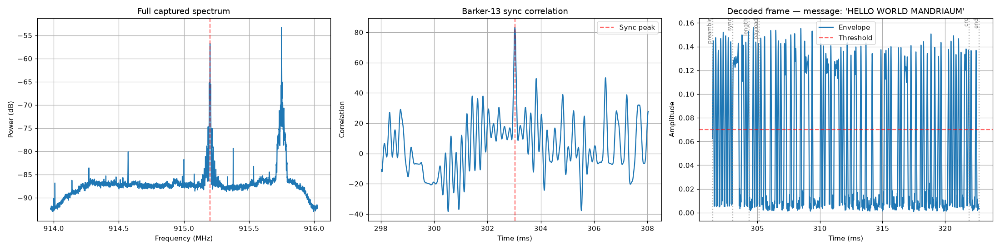
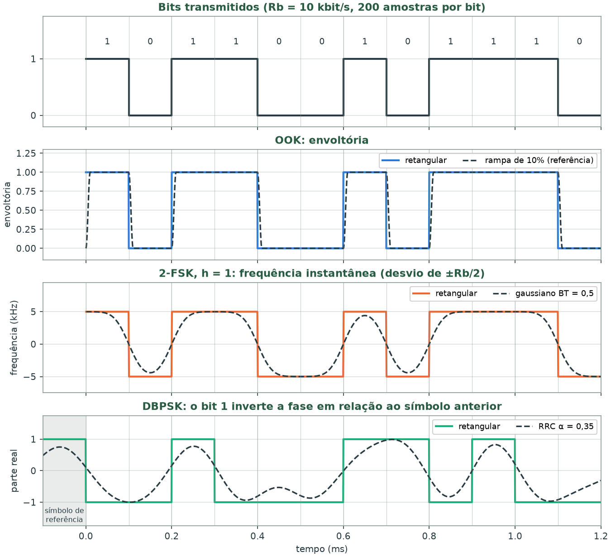
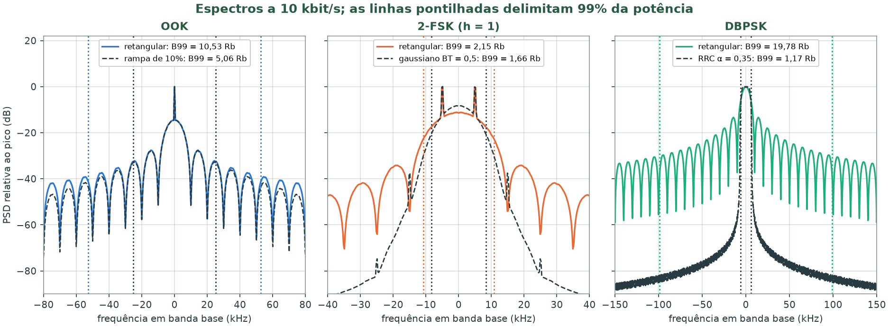
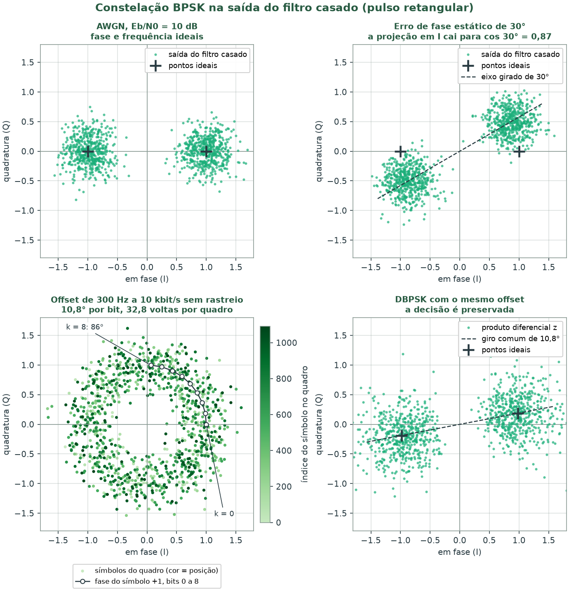
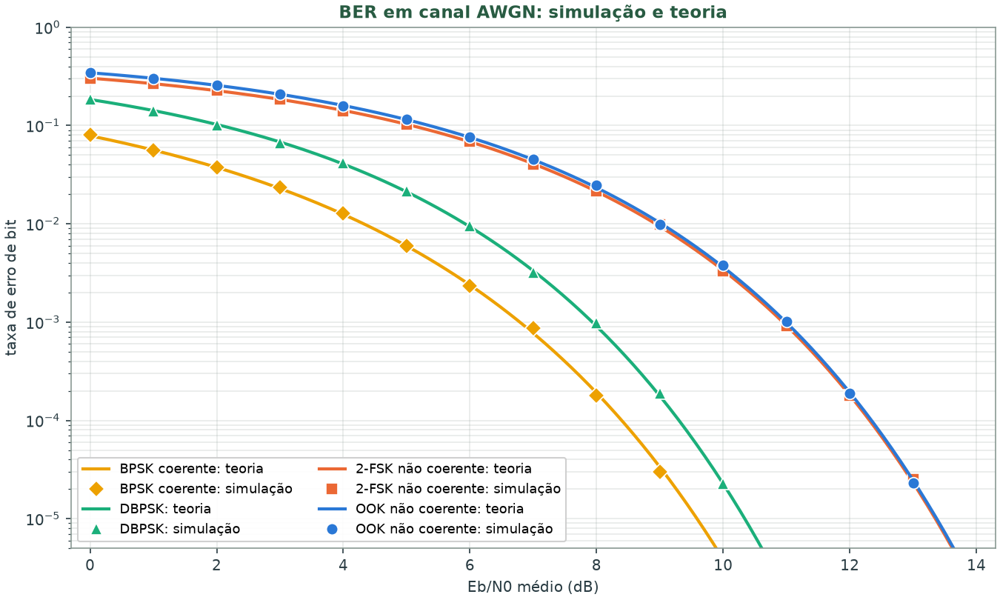
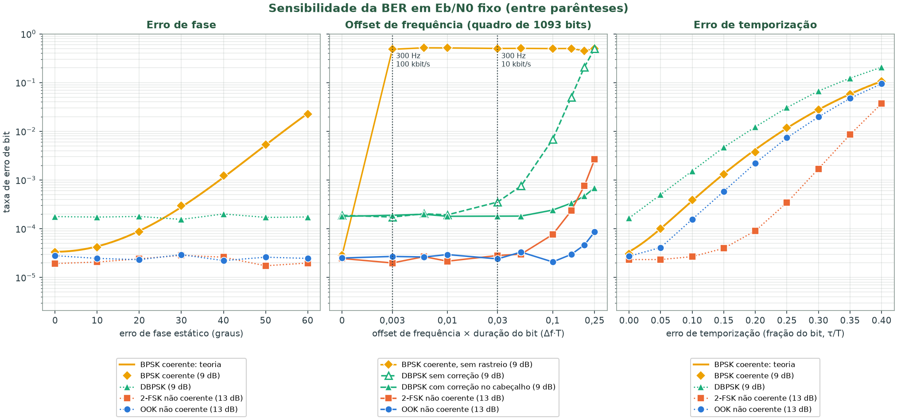
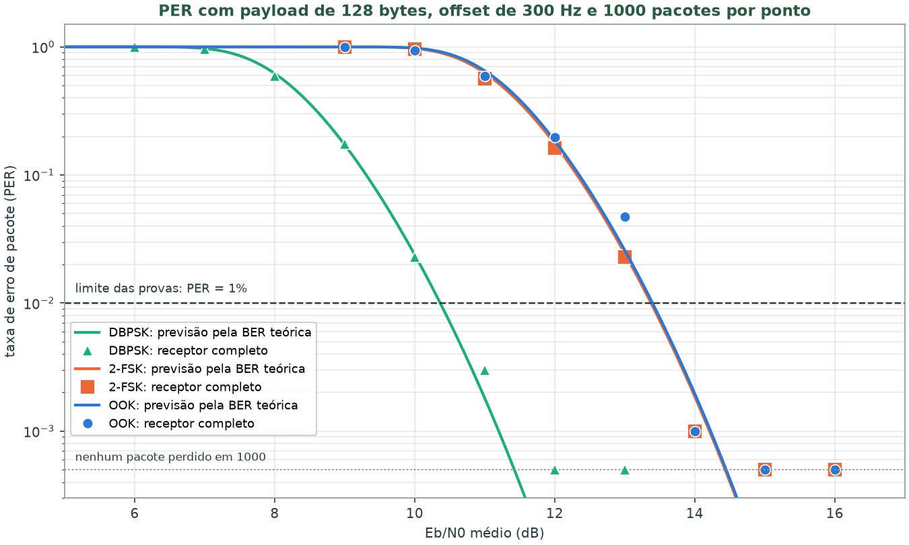
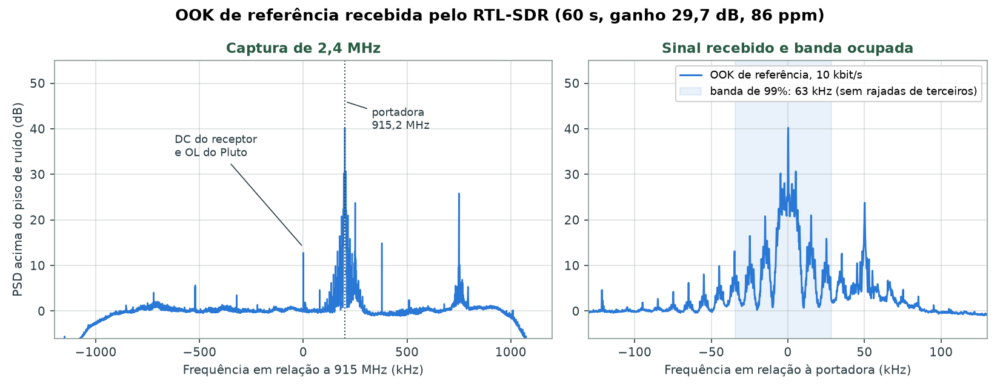
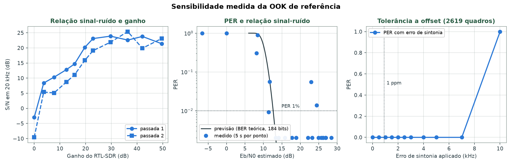

# Projeto final - Link de comunicação SDR

## Resumo executivo

O projeto parte de um enlace OOK funcional entre um ADALM-Pluto e um RTL-SDR e pede 2-FSK e BPSK, pacotes com número de sequência e medidas de PER, goodput, BER e banda ocupada. Este relatório parcial cobre as etapas 1 a 4 e a parte das etapas 5 e 6 que foi possível medir com o transmissor de referência no ar.

A OOK de referência foi auditada, executada e medida. Em 60 s de captura o receptor do projeto recuperou 2.619 de 2.619 quadros, com goodput de 7.333 bit/s para o payload de 21 bytes do exemplo. A calibração encontrou 56 ppm em um RTL-SDR e 86 ppm no outro, enquanto o código entregue traz 34 ppm. Com 34 ppm o receptor de referência não decodifica nenhum quadro nesses aparelhos.

As modulações 2-FSK e DBPSK, o quadro com sequência e CRC-16 e o receptor de pacotes funcionam em simulação e em capturas sintéticas com o mesmo formato do RTL-SDR. A PER de 1% exige 10,4 dB de Eb/N0 na DBPSK e 13,3 a 13,4 dB na 2-FSK e na OOK. As novas modulações ainda não foram transmitidas pelo Pluto, e por isso a comparação entre simulação e medição existe apenas para a OOK.

## 1. Auditoria da OOK de referência

O transmissor monta um quadro, converte os bits em envoltória e multiplica por uma portadora complexa de 200 kHz. O Pluto repete esse buffer continuamente em 915 MHz, de modo que o sinal fica em 915,2 MHz, afastado do componente DC do receptor. O receptor captura 0,5 s, desloca 200 kHz para baixo, filtra, extrai a envoltória e procura um único quadro.

| Bloco | Função no código | O que faz |
|---|---|---|
| Quadro | build_frame_bits | Preâmbulo 1010..., Barker-13, comprimento, payload e CRC-8 |
| Envoltória | build_ook_envelope | 200 amostras por bit, rampa de 20 amostras nas transições |
| Captura | capture_chunks | Leituras síncronas de 262.144 amostras |
| Filtro | simple_lowpass | FIR de 2.705 coeficientes, ±10 kHz, depois 903 coeficientes |
| Sincronismo | np.correlate | Correlação da envoltória com o Barker-13, pico máximo |
| Limiar | preamble_levels | Média entre os níveis 1 e 0 do preâmbulo conhecido |
| Decisão | read_bits | Média da envoltória em cada bit, 204,8 amostras por bit |
| Validação | crc8 | Polinômio 0x07, calculado só sobre o payload |

A leitura do código levantou seis pontos que orientam o restante do projeto.

- O valor de ppm está fixo em 34 e vale para um dongle específico. Cada 1 ppm desloca o sinal 915 Hz, e o filtro de ±10 kHz deixa de conter a portadora com cerca de 11 ppm de erro.
- O receptor decodifica um quadro por execução. O máximo da correlação sempre existe, mesmo sem sinal, e o CRC-8 passa a ser a única barreira contra um quadro falso.
- O comprimento não é protegido pelo CRC. Um erro nesse campo muda a quantidade de bits lidos.
- A busca reserva espaço para 64 bytes de payload, menos que os 128 bytes das provas.
- Não há recuperação de relógio. Com osciladores de 50 ppm, o deslizamento em um quadro de 1.085 bits é de 0,05 bit, pequeno o bastante para a leitura por taxa nominal.
- A mensagem é convertida para ASCII, o que impede payloads binários arbitrários.

O quadro de referência com 128 bytes tem 1.085 bits. A 10 kbit/s ele dura 108,5 ms e entrega no máximo 9.438 bit/s. Esse cálculo confirma a observação do enunciado de que a referência não atinge 10 kbit/s de goodput.

O CRC-8 0x07 tem período 127. Dois bits invertidos separados por 127 posições produzem o mesmo CRC. Em uma palavra de 1.032 bits há 3.684 pares assim entre 531.996, e o teste mostrou que nenhum deles é detectado. Com quadros aleatórios, a aceitação falsa medida foi 0,39%.

### Execução nos rádios

O receptor de referência foi executado sem alteração do arquivo. Somente a constante de ppm foi substituída em memória. A tabela reúne as execuções registradas em resultados/.

| Dongle | ppm usado | Resultado do receptor de referência |
|---|---|---|
| A | 34 (original) | Comprimento 0, CRC recebido 0x7f e calculado 0x00, falha |
| A | 56 (calibrado) | HELLO WORLD MANDRIAUM, CRC-8 0x44, válido |
| B | 86 (calibrado) | HELLO WORLD MANDRIAUM, CRC-8 0x44, válido |

## 2. Quadro e arquitetura do projeto

O quadro reutiliza o preâmbulo e o Barker-13 e acrescenta 16 bits de sequência. O CRC passa a ser o CRC-16/CCITT, com polinômio 0x1021, e cobre comprimento, sequência e payload. A guarda é silêncio nas três modulações.

| Campo | Referência | Projeto |
|---|---|---|
| Preâmbulo e Barker-13 | 29 bits | 29 bits |
| Comprimento | 8 bits | 8 bits |
| Sequência | não há | 16 bits |
| Payload de 128 bytes | 1.024 bits | 1.024 bits |
| Verificação | CRC-8, 8 bits | CRC-16, 16 bits |
| Guarda | 16 bits | 16 bits |
| Total | 1.085 bits | 1.109 bits |
| Eficiência | 94,4% | 92,3% |

O CRC-16 custa 8 bits a mais por quadro, 0,7% do total. Em 1.064 bits protegidos, o teste exaustivo dos 565.516 erros de 2 bits não encontrou nenhum caso não detectado. A aceitação falsa de quadros aleatórios caiu para 0,0014%. Um CRC-32 reduziria esse valor, mas o ganho não compensa mais 16 bits enquanto a PER permitida é de 1%.

Com 1.109 bits por quadro, o goodput de 10 kbit/s exige pelo menos 10.830 bit/s com PER nula e 10.940 bit/s com PER de 1%.

O receptor usa a mesma cadeia para as três modulações. A captura é deslocada para 0 Hz e reamostrada para oito amostras por bit, um número inteiro. Cada modulação tem um detector que produz um valor por amostra, e daí em diante o processamento é comum.

| Modulação | Detector | Valor de decisão |
|---|---|---|
| OOK | Integração de um bit e módulo | Envoltória comparada ao limiar do preâmbulo |
| 2-FSK, h = 1 | Dois correlatores não coerentes, em ±Rb/2 | Diferença dos módulos |
| DBPSK | Integração ou RRC casado, produto com o símbolo anterior | Parte real depois de remover o giro comum |

O sincronismo correlaciona esse valor com os 29 bits conhecidos e normaliza pela energia local. O resultado fica entre 0 e 1 e independe do ganho. Um quadro só é lido quando a correlação passa de 0,6. Depois de um CRC válido a busca salta para o fim do quadro. Depois de um CRC inválido ela avança um bit.

Na DBPSK a correlação é complexa. O módulo detecta o quadro e o ângulo mede o giro de fase por bit, que é proporcional ao offset de frequência. Esse giro é removido antes da decisão. Na OOK e na 2-FSK o offset é estimado pela fase entre bits iguais do preâmbulo e serve para o registro de calibração.

## 3. Novas modulações em simulação

Os moduladores usam os parâmetros da referência, 10 kbit/s e 200 amostras por bit. Cada modulação tem o pulso retangular e uma alternativa: rampa de 10% na OOK, filtro gaussiano com BT = 0,5 na 2-FSK e raiz de cosseno levantado com roll-off 0,35 na DBPSK.

A banda ocupada é a faixa que deixa 0,5% da potência de cada lado. A relação entre pico e média importa porque o conversor do Pluto é limitado em pico: um sinal com 4 dB de PAPR transmite 4 dB a menos de potência média.

| Variante | Banda de 99% | PAPR | Taxa máxima em 1 MHz |
|---|---|---|---|
| OOK retangular | 10,53 Rb | 3,0 dB | 95 kbit/s |
| OOK com rampa de 10% | 5,06 Rb | 3,1 dB | 198 kbit/s |
| 2-FSK retangular | 2,15 Rb | 0 dB | 465 kbit/s |
| 2-FSK gaussiana | 1,66 Rb | 0 dB | 602 kbit/s |
| DBPSK retangular | 19,78 Rb | 0 dB | 51 kbit/s |
| DBPSK com RRC | 1,17 Rb | 4,1 dB | 853 kbit/s |

O valor teórico da BPSK retangular é 20,57 Rb em tempo contínuo e 20,39 Rb com 200 amostras por bit. A medida variou entre 19,43 e 20,26 Rb em blocos de 20.000 bits, porque a cauda do espectro é quase plana perto de 99%. A OOK ocupa cerca de metade porque a linha da portadora concentra metade da potência. A 2-FSK com h = 1 mantém fase contínua e por isso tem lóbulos baixos mesmo com pulso retangular.

A regra de 1 MHz limita a DBPSK retangular a 51 kbit/s. Com RRC, o limite sobe para 853 kbit/s e passa a ser imposto pela taxa de amostragem do RTL-SDR, que a 2,4 MS/s entrega menos de três amostras por símbolo nessa taxa.

## 4. Canal simulado

As curvas usam Eb/N0 definido pela energia média por bit e até 4 milhões de bits por ponto. As quatro curvas simuladas coincidem com as expressões teóricas dentro do erro estatístico.

| Esquema | Eb/N0 para BER de 0,001 | Eb/N0 para PER de 1% | Mesma potência de pico |
|---|---|---|---|
| BPSK coerente | 6,79 dB | 9,61 dB | 9,61 dB |
| DBPSK retangular | 7,93 dB | 10,37 dB | 10,37 dB |
| DBPSK com RRC | 7,93 dB | 10,37 dB | 14,43 dB |
| 2-FSK não coerente | 10,94 dB | 13,38 dB | 13,38 dB |
| OOK não coerente | 10,99 dB | 13,40 dB | 16,41 dB |

A PER de 1% em 1.064 bits protegidos equivale a uma BER de 0,00000945. A última coluna soma a perda de potência média de cada forma de onda quando o pico é o mesmo. A OOK fica desligada metade do tempo e perde 3,0 dB. A DBPSK com RRC perde 4,1 dB.

### DBPSK no lugar da BPSK coerente

A DBPSK precisa de 1,14 dB a mais que a BPSK coerente em BER de 0,001 e de 0,75 dB a mais no alvo de PER de 1%. Em troca, dispensa a referência de fase. Um offset residual de 300 Hz a 10 kbit/s gira a fase 10,8° por bit. A referência de fase tomada no início do quadro chega a 90° de erro em 8,3 bits e dá 32,8 voltas em um quadro. Na simulação, a BPSK coerente sem rastreio teve BER de 0,50 com esse offset, enquanto a DBPSK manteve a BER do caso sem offset.

Esse é o motivo da escolha. Uma BPSK coerente exigiria uma malha de portadora capaz de seguir centenas de hertz dentro de cada quadro, e o ganho máximo seria de 0,75 dB.

| Efeito | BPSK coerente | DBPSK | 2-FSK | OOK |
|---|---|---|---|---|
| Fase estática de 30° | 9 vezes maior | sem efeito | sem efeito | sem efeito |
| Offset de 0,03 Rb | BER 0,50 | 1,9 vez maior | sem efeito | sem efeito |
| Offset de 0,10 Rb | BER 0,50 | BER 0,0069 | BER 0,000076 | sem efeito |
| Temporização de 0,1 bit | BER 0,00039 | BER 0,0015 | BER 0,000027 | BER 0,00016 |
| Temporização de 0,2 bit | BER 0,0037 | BER 0,012 | BER 0,000091 | BER 0,0022 |

A coluna da DBPSK mostra o detector sem correção de giro. Com a correção pelo cabeçalho, que é a usada no receptor, a BER fica igual à do caso sem offset em 0,03 Rb e sobe apenas para 0,00024 em 0,10 Rb.

Os valores de BER usam 9 dB para BPSK e DBPSK e 13 dB para 2-FSK e OOK. O offset de 300 Hz corresponde a 0,03 Rb em 10 kbit/s e a 0,003 Rb em 100 kbit/s. Aumentar a taxa de bits reduz o efeito do mesmo offset em hertz. A 2-FSK é a mais tolerante a erro de temporização e a DBPSK é a mais sensível, porque o erro atinge dois símbolos consecutivos.

## 5. Protocolo e receptor completo

A simulação de pacotes usa o receptor inteiro, com busca de quadro, estimativa de limiar e de giro, leitura dos campos e CRC-16. Cada ponto tem 1.000 pacotes de 128 bytes a 12 kbit/s, com atraso aleatório, fase aleatória, offset de 300 Hz e ruído.

| Eb/N0 | OOK | 2-FSK | Eb/N0 | DBPSK |
|---|---|---|---|---|
| 11 dB | 0,590 | 0,565 | 8 dB | 0,595 |
| 12 dB | 0,196 | 0,163 | 9 dB | 0,174 |
| 13 dB | 0,047 | 0,023 | 10 dB | 0,023 |
| 14 dB | 0,001 | 0,001 | 11 dB | 0,003 |
| 15 dB | 0 | 0 | 12 dB | 0 |

O Eb/N0 mínimo para PER de 1% foi 13,40 dB na OOK, 13,27 dB na 2-FSK e 10,41 dB na DBPSK. A previsão pela BER teórica é 13,40, 13,38 e 10,37 dB. A perda de implementação do sincronismo e da leitura em oito amostras por bit ficou abaixo de 0,1 dB, menor que a incerteza estatística de cerca de 0,2 dB. Nenhum pacote foi aceito com conteúdo diferente do transmitido. O goodput medido sem perdas foi 11.071 bit/s, para um máximo de 11.080 bit/s.

O último teste reproduz a cadeia do rádio. O sinal é gerado a 2 MS/s com deslocamento de 200 kHz, reamostrado para 2,4 MS/s, recebe erro de portadora de 1,5 kHz e ruído e é gravado em 8 bits. As três modulações tiveram PER nula em 60 pacotes a 20 kbit/s, e o offset estimado foi 1.502, 1.495 e 1.499 Hz. O mesmo arquivo de transmissão foi verificado a seco nas seis variantes, até 50 kbit/s com RRC.

A curva de PER revelou um defeito na escolha do pico de sincronismo. Quando o limiar era cruzado por um lóbulo do preâmbulo mais de quatro bits antes do pico, o quadro era perdido. Isso ocorria uma vez em 25.000 pacotes. A busca passou a subir até o máximo local, e o ponto de 13 dB da DBPSK voltou a zero.

## 6. Calibração e medições de bancada

As medições usaram o transmissor de referência no Pluto, em 915 MHz com ganho de -20 dB, e dois RTL-SDR com sintonizador R820T a 2,4 MS/s e ganho manual. A distância e as antenas não foram registradas. Na mesma faixa há emissores de terceiros que transmitem rajadas de cerca de 30 ms e saltam entre 915,15, 915,20, 915,25 e 915,75 MHz.

### Calibração de ppm

A calibração mede a posição da linha da portadora com resolução de 2,3 Hz, converte o erro em ppm, aplica a correção inteira e mede o resíduo.

| Dongle | Erro sem correção | Correção | Offset residual |
|---|---|---|---|
| A | 51.112 Hz | 56 ppm | +343 Hz, desvio de 17 Hz |
| B | 78.160 Hz, a partir de 84 ppm | 86 ppm | +406 Hz, depois +264 Hz |

O resíduo ficou em centenas de hertz porque a correção é inteira e 1 ppm vale 915 Hz. Ele também varia no tempo. O dongle A, recém-ligado, derivou de +251 para +970 Hz em 30 s. O dongle B derivou de +261 para -361 Hz em 60 s. Uma tentativa de calibração foi enganada por uma rajada de terceiros a 50 kHz da portadora, e a busca passou a ser restrita a ±15 kHz depois do primeiro ajuste.

### Ensaio de 60 segundos

| Métrica | Valor medido |
|---|---|
| Quadros válidos | 2.619 de 2.619 no intervalo |
| PER | 0, abaixo de 0,11% com 95% de confiança |
| Goodput | 7.333 bit/s, para um máximo de 7.336 bit/s |
| Relação sinal-ruído em 20 kHz | 24,2 dB |
| Offset residual por quadro | média de +56 Hz, desvio de 171 Hz |
| Banda de 99% | 63 kHz sem as rajadas de terceiros, 87 kHz com elas |
| Processamento | 7,8 s para 60 s de captura |

O goodput é baixo porque o exemplo transmite 21 bytes por quadro, com eficiência de 73%. O processamento usa 1,3% dos 10 minutos permitidos nas provas. No dongle A, uma captura de 30 s teve 1.308 quadros válidos e um perdido.

A banda de 99% simulada para a OOK com rampa é 50,6 kHz. A medida, sem os blocos atingidos por rajadas, foi 63 kHz, 24% maior. O lado inferior da medida, livre do emissor vizinho, tem 34 kHz, contra 25 kHz na simulação. A diferença restante ainda não tem causa confirmada. As hipóteses são ruído residual depois da subtração do piso e a resposta real do transmissor.

### Sensibilidade

A relação sinal-ruído foi variada pelo ganho do RTL-SDR, em duas passadas de 5 s por ponto. Abaixo de 20 dB de ganho domina o ruído interno do receptor, que não depende do ganho, e o sinal-ruído cai.

A PER foi nula nos pontos com pelo menos 10 dB de sinal-ruído em 20 kHz, cerca de 13 dB de Eb/N0. Com 8,4 e 8,7 dB a PER foi 0,9% e 5,6%, e com 5,1 dB foi 30%. A previsão para o quadro de 184 bits protegidos é PER de 1% em 12,6 dB de Eb/N0. Medição e previsão concordam dentro de 1 a 2 dB, que é a incerteza do sinal-ruído estimado.

Dois pontos fogem da tendência. Com 42,1 dB de ganho a PER foi 5,5% apesar de 19,9 dB de sinal-ruído, e com 49,6 dB foi 1,4%, com 0,26% das amostras saturadas. Entre as passadas o sinal-ruído no mesmo ganho mudou de 3 a 5 dB, o que indica canal variável. A primeira varredura, de 8 s por ponto, saiu irregular e foi repetida. Ela permanece no arquivo de resultados.

O erro de sintonia foi aplicado digitalmente à captura de 60 s. Os 2.619 quadros foram recuperados com até 7 kHz de erro, 7,6 ppm. Com 10 kHz a recepção falha, porque a integração de um bit de 100 µs anula um tom deslocado de 10 kHz. O resultado não mudou com 4, 8 ou 16 amostras por bit.

## 7. Escolhas para as provas e análise de cenários

Os resultados apontam configurações iniciais para as duas categorias. Elas dependem de confirmação no ar.

- Alcance. A DBPSK retangular a 12 kbit/s tem envoltória constante, exige 10,4 dB de Eb/N0 e ocupa 237 kHz. Em potência de pico igual, ela tem 3,0 dB de vantagem sobre a 2-FSK e 6,0 dB sobre a OOK.
- Velocidade. A regra de 1 MHz favorece a DBPSK com RRC ou a 2-FSK gaussiana. A taxa útil será limitada pela amostragem do RTL-SDR e pela PER de 1%.

E se o ppm não for calibrado? O receptor do projeto tolera 7 kHz na OOK a 10 kbit/s, cerca de 7 ppm. Os dois dongles medidos erram 56 e 86 ppm, e sem calibração nenhum quadro é recebido.

E se o receptor aquecer durante a prova? A deriva medida chegou a 24 Hz/s logo após ligar. Em 60 s isso soma mais de 1 kHz. A estimativa de offset por quadro acompanha a deriva, mas o aquecimento de 10 minutos continua necessário para manter o sinal no centro do filtro.

E se a taxa subir para 100 kbit/s? O mesmo offset em hertz gira dez vezes menos fase por bit, e a tolerância a erro de sintonia cresce na mesma proporção. A DBPSK retangular deixa de caber em 1 MHz acima de 51 kbit/s.

E se o CRC-8 fosse mantido? Cerca de 0,39% dos quadros corrompidos seriam aceitos. Como o conteúdo errado conta como falha, uma PER bruta de 1% já traria erros não detectados ao arquivo de saída.

E se houver outro emissor na faixa? Houve um quadro perdido em 1.309 no dongle A e nenhum em 2.619 no dongle B, e a banda de 99% medida passou de 63 para 87 kHz. Rajadas curtas custam poucos quadros, mas atrapalham a calibração e a medida de banda.

## 8. Situação das etapas

A tabela resume o que está pronto e o que depende de novos ensaios com os rádios.

| Etapa | Situação |
|---|---|
| 1. Auditoria da referência | Concluída, com recepção válida registrada em dois RTL-SDR |
| 2. Novas modulações | Concluída em simulação |
| 3. Simulação do canal | Concluída |
| 4. Integração do protocolo | Concluída em simulação e em captura sintética |
| 5. Integração SDR e calibração | Calibração concluída; 2-FSK e DBPSK ainda não transmitidas pelo Pluto |
| 6. Caracterização | Feita para a OOK de referência; pendente para as novas modulações |
| 7. Otimização | Não iniciada |
| 8. Competição e defesa | Não iniciada |

O próximo passo é executar tx_pluto.py no computador do Pluto e repetir a caracterização com rx_roteiro.py. O transmissor foi testado apenas a seco. Também falta registrar distância e antenas, medir BER com sequência conhecida no ar e implementar a transmissão sem repetição cíclica exigida nas provas.

## Registro de uso de IA

O código, as simulações e a redação inicial foram produzidos com o Claude Code. As verificações foram vetores de teste dos CRC, comparação entre simulação e teoria, ensaio a seco do transmissor e medição com os rádios. O registro por etapa está em registro_ia.md.
